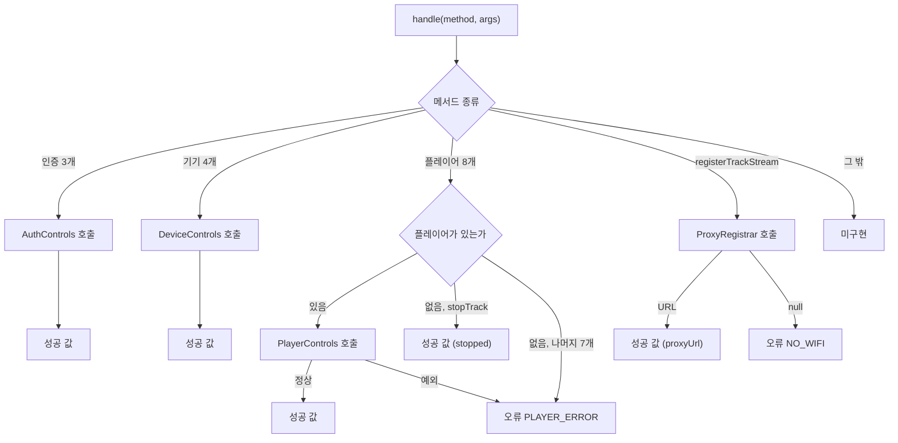
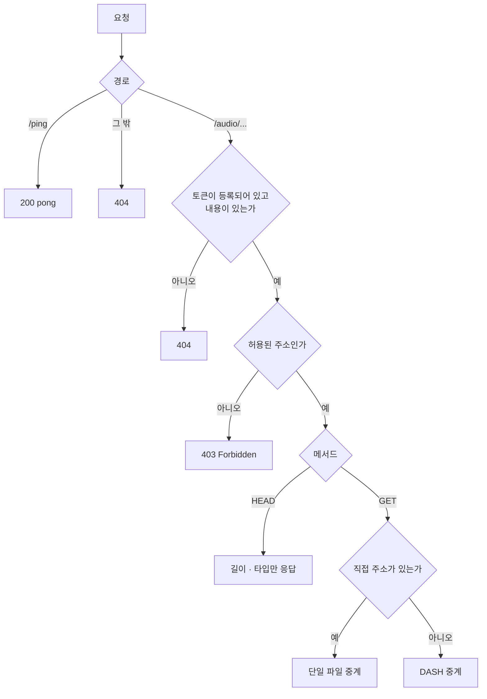
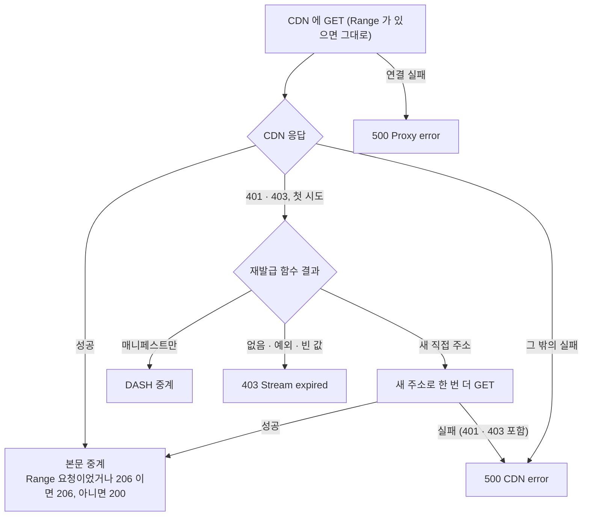

# 비즈니스 로직 모델 (Business Logic Model) - android-native-tests

`PlaybackCommandRouter` 와 `TidalStreamProxyServer` 의 동작 흐름을 모델로 적는다. 규칙 ID (`CR-01` 등) 는 `business-rules.md` 를 가리킨다. 끝에 "테스트 가능한 속성" 절이 있다 (PBT-01).

## 1. `PlaybackCommandRouter`

### 1.1 분배



텍스트 대안: router 는 메서드 이름으로 네 갈래 가운데 하나를 고른다. 인증 3개 (`initTidalAuth`, `updateUserCredentials`, `clearUserCredentials`) 와 기기 4개 (`getPhoneVolume`, `setPhoneVolume`, `requestNotificationPermission`, `setStreamingLock`) 는 협력 객체를 부르고 성공 값을 돌려준다. 플레이어 8개는 플레이어가 있으면 부르고, 예외가 나면 `PLAYER_ERROR` 로 바꾼다. 플레이어가 없으면 `stopTrack` 만 성공이고 나머지 7개는 `PLAYER_ERROR` 다. `registerTrackStream` 은 URL 을 받으면 성공, null 이면 `NO_WIFI` 다. 그 밖의 이름은 미구현이다 (CR-01 ~ CR-08).

### 1.2 인자 해석

| 종류 | 읽는 방법 | 없거나 타입이 다를 때 |
| --- | --- | --- |
| 문자열 | 값이 문자열이면 그대로 | 메서드별 기본값 (대부분 `""`, `quality` 는 `"LOSSLESS"`, `mimeType` 은 `"audio/mp4"`) |
| 정수 | 값이 숫자면 Int 로 (`expiresInSeconds` 는 Long 으로) | 0 (`expiresInSeconds` 는 3600) |
| 불리언 | 값이 정확히 true 인가 | false |

router 는 상태를 갖지 않는다. 플레이어는 생성자에서 받은 함수로 호출할 때마다 조회한다 (`initTidalAuth` 가 성공해야 생기므로).

### 1.3 `PlaybackCore` 와의 경계

```text
MethodChannel --> PlaybackCore.onMethodCall(call, result)
                    |  call.method, call.arguments
                    v
                  PlaybackCommandRouter.handle(method, args) --> CommandResult
                    |
                    v
                  result.success / result.error / result.notImplemented
```

`PlaybackCore` 에 남는 것: 채널 연결 (`attach`), 이벤트 전송, 볼륨 관찰, WifiLock, 프록시 서버의 수명 관리, Dart 로 되묻는 요청, 협력 인터페이스의 운영 구현 (PC-01 ~ PC-07).

## 2. `TidalStreamProxyServer`

### 2.1 곡 등록

```text
registerTrackStream(trackId, directUrl, manifestXml, allowedHost, mimeType)
  1. 새 토큰 (16자 16진수) 을 만든다
  2. MIME 을 정한다: DASH 만 있으면 audio/mp4, 아니면 받은 값 (비어 있으면 audio/mp4)
  3. 토큰 -> 곡 정보를 등록부에 넣는다. 4개째가 되면 가장 오래된 것을 지운다
  4. http://<주소>:<포트>/audio/<토큰>.<MIME 에 맞는 확장자> 를 돌려준다
```

등록부는 "최근에 등록한 3개" 를 가진 대기 줄이다 (PX-01 ~ PX-06).

### 2.2 요청 처리 순서



텍스트 대안: `/ping` 은 `pong`, `/audio/` 가 아닌 경로는 404 다. `/audio/` 요청은 등록 여부 → 접근 제어 → 메서드 순서로 판정한다. 등록되지 않았거나 내용이 비어 있으면 404, 허용되지 않은 주소면 403 이다. 통과하면 HEAD 는 길이와 타입만, GET 은 직접 주소가 있으면 단일 파일 중계, 없으면 DASH 중계로 응답한다 (PX-07 ~ PX-15).

### 2.3 단일 파일 중계와 주소 재발급



텍스트 대안: CDN 응답이 성공이면 본문을 중계한다. 첫 시도에서 401 · 403 이면 재발급 함수를 한 번 부른다. 새 직접 주소를 받으면 한 번 더 요청하고, 매니페스트만 받으면 DASH 로 응답하고, 받지 못하면 `Stream expired` 다. 두 번째 시도도 실패하면 다시 재발급하지 않고 `CDN error` 다. 재발급에 성공하면 등록부의 주소도 바뀌어 다음 요청은 새 주소를 바로 쓴다 (PX-21 ~ PX-33).

### 2.4 DASH 중계

```text
매니페스트 해석 --실패--> 500 Invalid DASH manifest
   |
   v
전체 길이 = 초기화 세그먼트 + 모든 세그먼트의 HEAD 길이 합 (매니페스트당 한 번 계산해 기억)
   |          하나라도 모르면 길이 없음
   v
본문 = 초기화 세그먼트, 세그먼트 1, 2, ... 를 순서대로 이어 붙인 스트림
```

이어 붙인 스트림은 바이트 위치로 탐색할 수 없어 `Accept-Ranges` 를 알리지 않는다 (코드 주석, PX-34 ~ PX-38).

---

## 3. 테스트 가능한 속성 (Testable Properties)

PBT-01 의 분류를 괄호에 적었다. 입력 범위는 `domain-entities.md` 의 생성기 절에 있다.

### `PlaybackCommandRouter`

| ID | 속성 | 분류 |
| --- | --- | --- |
| P-CR-1 | 16개 메서드가 아닌 어떤 이름에 대해서도 결과는 미구현이고 협력 객체 호출이 0회 | 불변 조건 |
| P-CR-2 | 플레이어가 없으면, 플레이어 동작 7개와 어떤 인자에 대해서도 결과는 `PLAYER_ERROR` 와 정해진 메시지. `stopTrack` 은 성공 | 불변 조건 |
| P-CR-3 | 플레이어가 어떤 메시지의 예외를 던져도, 플레이어 동작 8개의 결과는 `PLAYER_ERROR` 이고 메시지는 예외의 메시지 (없으면 클래스 이름) | 불변 조건 |
| P-CR-4 | 인자가 그대로 전달된다: `playTrack` · `setNextTrack` 의 `trackId`, `seekTrack` 의 `positionMs`, `setAudioQuality` 의 `quality`, `updateUserCredentials` 의 세 값, `setPhoneVolume` 의 `percent` 가 어떤 값이든 협력 객체가 받은 값과 성공 값에 실린 값이 입력과 같음 | 불변 조건 |
| P-CR-5 | `registerTrackStream`: 다섯 인자가 어떤 문자열이든 등록 함수가 받은 값이 입력과 같고, 등록 함수가 돌려준 어떤 URL 이든 성공 값의 `proxyUrl` 과 같음. 인자를 임의로 빼면 그 자리에 기본값이 들어감 | 불변 조건 |
| P-CR-6 | 어떤 메서드와 인자에 대해서도 같은 호출을 두 번 하면 결과가 같음 (협력 객체가 같은 답을 줄 때) | 멱등성 (결과의 결정성) |

### `TidalStreamProxyServer`

| ID | 속성 | 분류 |
| --- | --- | --- |
| P-PX-1 | 몇 번을 등록하든 돌려준 주소는 모두 `http://<주소>:<포트>/audio/<16자 16진수>.<확장자>` 형식이고 토큰이 서로 다름 | 불변 조건 |
| P-PX-2 | 어떤 MIME 문자열에 대해서도 확장자가 참조 표 (PX-02 의 순서) 와 같음 | 오라클 |
| P-PX-3 | 어떤 횟수의 등록 순서에 대해서도, 등록할 때마다 "최근 3개" 모델과 비교하면: 모델에 있는 주소는 404 가 아니고, 모델에서 밀려난 주소는 404 | 상태 기반 (모델 비교, PBT-06) |
| P-PX-4 | 어떤 `allowedHost` 에 대해서도, 빈 값이거나 요청한 쪽의 주소와 같을 때만 통과하고 그 밖에는 403 | 불변 조건 |
| P-PX-5 | 어떤 `Range` 값 (`bytes=a-b`, `bytes=a-`) 에 대해서도 CDN 이 받은 `Range` 가 요청의 값과 같음 | 불변 조건 |
| P-PX-6 | 어떤 바이트 내용에 대해서도, 등록한 곡을 GET 으로 받은 본문이 CDN 의 내용과 같음. DASH 는 어떤 세그먼트 내용 · 개수에 대해서도 본문이 초기화 세그먼트와 세그먼트들을 순서대로 이은 것과 같고 `Content-Length` 가 합계와 같음 | 왕복 (등록 → 조회) |

### 속성을 적용하지 않은 부분

| 부분 | 이유 |
| --- | --- |
| 주소 재발급 흐름 (PX-26 ~ PX-31) | 분기가 6개인 정해진 흐름이라 예시 기반 테스트로 모두 덮는다. 임의 입력으로 넓힐 변수가 없다. PBT 속성 없음 (No PBT properties identified) |
| HEAD 응답 (PX-16 ~ PX-20) | 길이를 그대로 전달하는 위임이다. 내용 보존은 P-PX-6 이 GET 으로 검증한다. PBT 속성 없음 |
| `PlaybackCore` 경계 (PC-01 ~ PC-07) | Android · Flutter 타입에 닿아 있고 로직이 없다. PBT 속성 없음 |

| 분류 | 적용하지 않은 이유 |
| --- | --- |
| 교환 법칙 | 순서를 바꿔도 결과가 같아야 하는 연산이 없다. 등록은 순서에 의존한다 (최근 3개) |
| 귀납 | 재귀 구조가 없다 |
| 쉬운 검증 | 계산은 어렵고 확인은 쉬운 연산이 없다 |

### PBT 와 예시 기반 테스트의 관계 (PBT-10)

`business-rules.md` 의 CR · PX 규칙은 모두 예시 기반 테스트로 검증한다. 위 속성은 그 위에 더한다.
