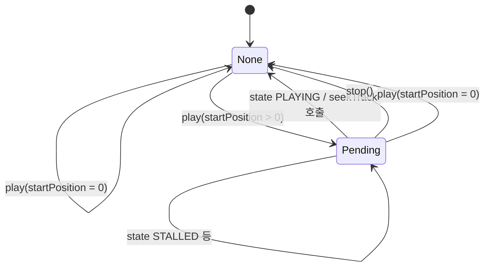
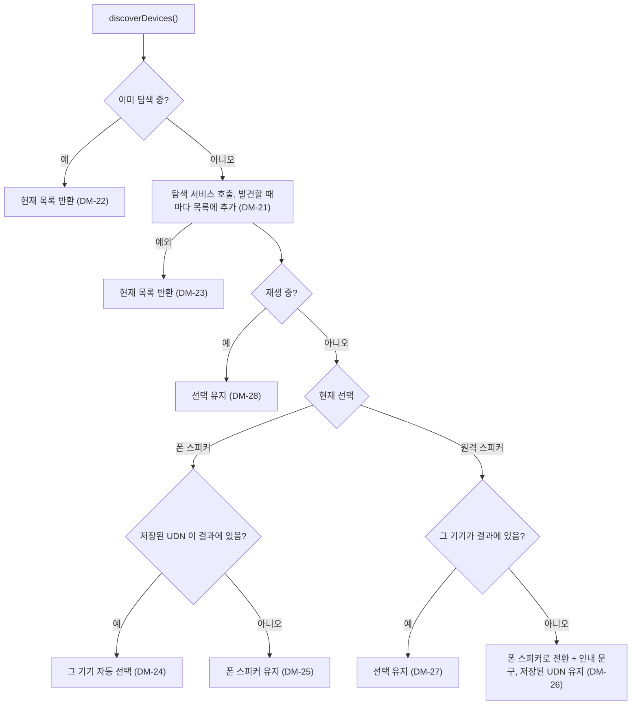
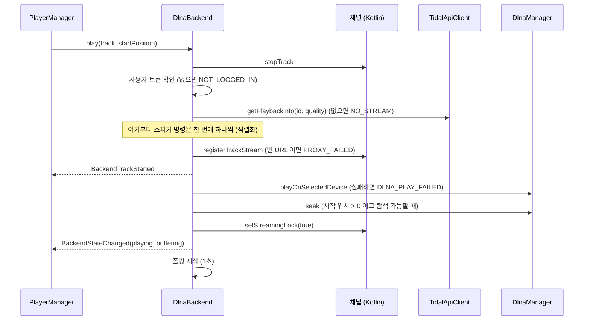
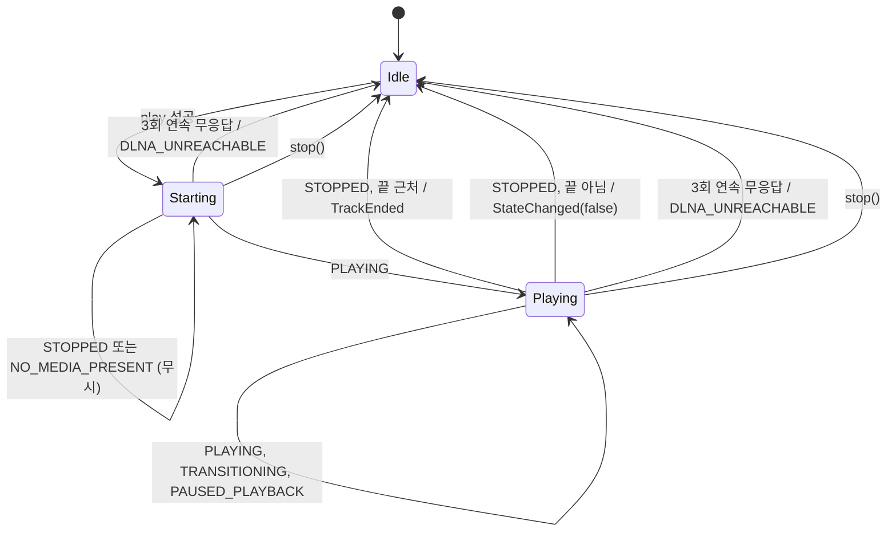

# 비즈니스 로직 모델 (Business Logic Model) - dart-playback-tests

대상 4개 컴포넌트의 동작 흐름과 상태를 모델로 적는다. 규칙 ID (`PB-01` 등) 는 `business-rules.md` 를 가리킨다. 이 문서의 끝에 "테스트 가능한 속성" 절이 있다 (PBT-01).

## 1. `PhoneBackend`

### 1.1 명령 흐름

```text
PlayerManager --play/pause/resume/seek/stop/setNext/setAudioQuality--> PhoneBackend
PhoneBackend --MethodChannel (playTrack, pauseTrack, ...)--> Kotlin
```

- 명령마다 채널 메서드 하나에 대응한다 (PB-01, PB-04 ~ PB-09)
- 실패를 예외로 알리는 명령은 `play`, `pause`, `resume` 뿐이다 (PB-02, PB-04, PB-05). `play` 는 요청이 취소되었으면 실패해도 조용히 끝난다 (PB-03)

### 1.2 이벤트 변환

입력은 네이티브 이벤트 맵, 출력은 `BackendEvent` 0개 또는 1개다. 변환은 상태 두 개 (현재 곡 ID, 현재 길이) 에만 의존한다.

| `type` | 출력 | 상태 변화 |
| --- | --- | --- |
| `state` | `BackendStateChanged` | 없음 (pending seek 적용은 1.3) |
| `position` | `BackendPositionChanged` (현재 길이 포함) | 없음 |
| `transition` | `BackendTrackStarted` | 현재 곡 ID, 현재 길이 갱신 |
| `ended` | `BackendTrackEnded` | 없음 |
| `error` | `BackendError` | 없음 |
| 그 밖 | 없음 | 없음 |

### 1.3 pending seek 상태 기계



텍스트 대안: 대기 중인 시작 위치는 "없음" 또는 "있음" 이다. 시작 위치가 0 보다 큰 `play` 가 "있음" 으로 만든다. "있음" 상태에서 `PLAYING` 이벤트가 오면 `seekTrack` 을 한 번 호출하고 "없음" 이 된다. `stop()` 이나 시작 위치 0 인 `play` 도 "없음" 으로 만든다. `PLAYING` 이 아닌 상태 이벤트는 상태를 바꾸지 않는다 (PB-11 ~ PB-15).

## 2. `DlnaManager`

### 2.1 명령 전달

```text
선택 기기가 폰 스피커  -> SOAP 없이 정해진 값 (DM-01 ~ DM-03)
선택 기기가 원격 스피커 -> 제어 URL 결정 (DM-04 ~ DM-06) -> SOAP 액션 (DM-07 ~ DM-18)
```

- 전송 명령과 볼륨 명령은 서로 다른 제어 URL 을 쓴다
- 재생 시작은 `Stop` → `SetAVTransportURI` → `Play` 의 고정 순서다 (DM-07 ~ DM-10)

### 2.2 시간 변환

- 보내는 쪽: 초 → `HH:MM:SS` (DM-12)
- 받는 쪽: `H:MM:SS[.fff]` → 초 (DM-16)
- 0 이상의 초에 대해 두 변환은 서로 역이다 (속성 P-DM-1)

### 2.3 탐색과 선택 정리



텍스트 대안: 탐색 중에 다시 부르면 현재 목록을 돌려준다. 탐색이 끝나면 선택을 정리한다. 재생 중이면 아무것도 바꾸지 않는다. 폰 스피커가 선택된 상태에서 저장된 UDN 의 기기가 보이면 그 기기를 고른다. 원격 스피커가 선택된 상태에서 그 기기가 안 보이면 폰 스피커로 돌리고 안내 문구를 남기되, 저장된 UDN 은 남겨 다음 탐색에서 복원되게 한다.

## 3. `DlnaBackend`

### 3.1 재생 흐름



텍스트 대안: `play` 는 폰 재생을 멈추고, 사용자 토큰과 스트림 정보를 확인한 뒤, 프록시에 등록해 받은 URL 로 스피커에 재생 명령을 보낸다. 곡 시작 이벤트는 스피커 명령 전에, 재생 상태 이벤트는 명령 성공 뒤에 나간다. 단계 사이마다 요청이 취소되었는지 확인하고, 취소되었으면 조용히 끝난다 (DB-01 ~ DB-15).

### 3.2 폴링 상태 기계

폴링 한 번의 입력은 (전송 상태, 위치 정보) 쌍이고 각각 null 일 수 있다.



텍스트 대안: 폴링은 재생 성공으로 시작한다. `PLAYING` 을 보기 전의 `STOPPED` 는 무시한다. `PLAYING` 을 본 뒤의 `STOPPED` 는 폴링을 끝내며, 마지막 위치가 끝에서 3초 안이면 (또는 길이를 모르면) 곡 끝, 아니면 재생 정지로 알린다. 상태와 위치가 모두 없는 응답이 3회 이어지면 폴링을 끝내고 `DLNA_UNREACHABLE` 을 알린다. `stop()` 은 언제든 폴링을 끝낸다 (DB-16 ~ DB-31).

보조 상태:
- 연속 무응답 횟수: 정상 응답이 오면 0 (DB-28)
- 마지막 위치: 0 보다 큰 위치만 기억 (DB-26)
- 스트리밍 잠금: 폴링 중일 때만 켜짐 (DB-07, DB-31)

### 3.3 갭리스

```text
setNext(track) -> 스트림 조회 -> 프록시 등록 -> SetNextAVTransportURI
   성공: 다음 곡 (곡, URL, 스트림 정보) 기억
   거부: 그 기기를 "갭리스 미지원" 으로 기억, 이후 시도 안 함

폴링에서 TrackURI 가 현재 URL 과 다르고 기억한 다음 곡 URL 과 경로 · 쿼리가 같으면:
   현재 곡을 다음 곡으로 교체, BackendTrackStarted 발생
```

주소 비교는 호스트 표기를 보지 않는다. 렌더러가 호스트를 바꿔 돌려주는 경우가 있기 때문이다 (코드 주석, DB-39).

### 3.4 명령 직렬화

스피커로 가는 명령 묶음 (`play` 의 등록 · SOAP, `setNext` 의 등록 · SOAP) 은 대기 줄에서 하나씩 실행된다. 앞 묶음이 실패해도 다음 묶음은 실행된다 (DB-15, DB-42).

## 4. `WaveAudioHandler`

### 4.1 두 방향

```text
시스템 (잠금화면, 알림, 블루투스) --명령--> WaveAudioHandler --> PlayerManager   (WA-01 ~ WA-09)
PlayerManager, DlnaManager 의 상태 변화 --> WaveAudioHandler --> playbackState, mediaItem, queue, androidPlaybackInfo   (WA-10 ~ WA-23)
```

### 4.2 알림 대응

| 바뀐 것 | 다시 알리는 것 |
| --- | --- |
| 재생 여부, 버퍼링, 진행 위치, 대기열 위치, 탐색 가능 여부 | `playbackState` |
| 현재 곡, 길이 | `mediaItem` |
| 대기열 | `queue` |
| 선택 기기, 볼륨 | `androidPlaybackInfo` |

상태를 갖지 않는다. 출력은 `PlayerManager` 와 `DlnaManager` 의 현재 값으로만 정해진다.

---

## 5. 테스트 가능한 속성 (Testable Properties)

PBT-01 의 분류를 괄호에 적었다. 속성 ID 는 Code Generation 계획에서 그대로 쓴다. 입력 범위는 `domain-entities.md` 의 생성기 절에 있다.

### `PhoneBackend`

| ID | 속성 | 분류 |
| --- | --- | --- |
| P-PB-1 | 계약 범위의 어떤 이벤트 맵에 대해서도 예외가 없고, 나오는 이벤트 수는 `type` 이 5종 중 하나면 1, 아니면 0 | 불변 조건 |
| P-PB-2 | 어떤 상태 문자열에 대해서도 `playing` 은 문자열이 `PLAYING` 또는 `STALLED` 일 때만 true, `buffering` 은 `STALLED` 일 때만 true | 오라클 (한 줄짜리 참조 식과 비교) |
| P-PB-3 | 0 이상의 어떤 `positionMs` 에 대해서도 나온 위치가 `Duration(milliseconds: positionMs)` 와 같음 | 불변 조건 |
| P-PB-4 | `transition` 이벤트: `duration` 이 null 인 것과 `durationMs` 가 0 이하이거나 없는 것이 일치하고, 있는 필드 값은 그대로 전달됨 | 불변 조건 |
| P-PB-5 | `play(시작 위치)`, 상태 이벤트, `stop()` 의 어떤 순서에 대해서도 pending seek 로 인한 `seekTrack` 호출이 1.3 의 모델과 같은 시점 · 같은 값으로 일어남 | 상태 기반 (모델 비교, PBT-06) |

### `DlnaManager`

| ID | 속성 | 분류 |
| --- | --- | --- |
| P-DM-1 | 0 이상의 어떤 초 s 에 대해서도, `seek(s)` 가 보낸 시간 문자열을 `RelTime` 으로 돌려주면 `syncPosition()` 의 `progressSeconds` 가 s | 왕복 |
| P-DM-2 | `seek(s)` 가 보내는 문자열은 항상 `숫자 2자리 이상:숫자 2자리:숫자 2자리` 형식이고 분 · 초 부분은 60 미만 | 불변 조건 |
| P-DM-3 | 어떤 정수 v 에 대해서도 `setVolume(v)` 가 SOAP 에 넘기는 값은 0 ~ 100 이고, v 가 범위 안이면 v 와 같음. `fetchVolume()` 도 렌더러가 준 값을 같은 방식으로 자름 | 오라클 (`clamp` 와 비교) |
| P-DM-4 | 시간 문자열 뒤에 소수 초를 붙여도 (`.fff`) 해석 결과가 같음. 어떤 문자열에 대해서도 `syncPosition()` 이 예외를 내지 않음 | 불변 조건 |
| P-DM-5 | `selectDevice(d)` 를 두 번 부른 결과 (선택, 저장된 UDN) 가 한 번 부른 결과와 같음. 같은 탐색 결과로 `discoverDevices()` 를 두 번 부른 뒤의 선택이 한 번 부른 뒤와 같음 | 멱등성 |
| P-DM-6 | 재생 중이 아닐 때, 어떤 탐색 결과와 어떤 이전 선택 · 저장 상태에 대해서도 탐색 뒤의 선택은 폰 스피커이거나 탐색 결과에 있는 기기. 재생 중일 때는 선택이 탐색 전과 같음 | 불변 조건 |

### `DlnaBackend`

| ID | 속성 | 분류 |
| --- | --- | --- |
| P-DB-1 | 어떤 폴링 응답 순서 (상태 × 위치, null 포함) 에 대해서도 나오는 이벤트 순서가 3.2 의 모델이 내는 순서와 같음. 모델에서 따라 나오는 불변 조건: `BackendTrackEnded` 는 많아야 1회, `PLAYING` 전에는 없음, 폴링이 끝난 뒤에는 이벤트 없음, `DLNA_UNREACHABLE` 은 무응답이 3회 이어진 때에만 | 상태 기반 (모델 비교, PBT-06) |
| P-DB-2 | P-DB-1 의 어떤 순서에 대해서도 마지막 `setStreamingLock` 값이 "폴링 중인가" 와 같음 | 불변 조건 |
| P-DB-3 | 갭리스 주소 비교: 등록한 주소에서 스킴 · 호스트 · 포트를 바꾸거나 앞뒤 공백을 붙여 돌려줘도 전환으로 인식. 경로나 쿼리가 다르면 인식하지 않음 | 불변 조건 |
| P-DB-4 | 어떤 IPv4 주소 · 포트로 된 기기 `locationUrl` 에 대해서도 `registerTrackStream` 의 `allowedHost` 가 그 주소 | 불변 조건 |
| P-DB-5 | 0 이상의 어떤 `RelTime` 초에 대해서도 `BackendPositionChanged.position` 이 `Duration(seconds: 그 값)` | 불변 조건 |

### `WaveAudioHandler`

| ID | 속성 | 분류 |
| --- | --- | --- |
| P-WA-1 | 어떤 곡에 대해서도 `mediaItem` 의 `id` · `title` · `artist` · `album` 이 곡 값과 같고, `duration` 이 null 인 것과 길이가 0 이하인 것이 일치하며, `artUri` 가 null 인 것과 `coverUrl` 이 빈 것이 일치 | 불변 조건 |
| P-WA-2 | 어떤 곡 목록에 대해서도 `queue` 의 길이와 순서 (ID 열) 가 목록과 같음 | 불변 조건 |

명령 전달 (WA-01 ~ WA-09) 과 재생 정보 알림 (WA-21 ~ WA-23) 에는 PBT 속성 없음 (No PBT properties identified): 입력을 변환하지 않고 그대로 넘기는 위임이라 예시 기반 테스트로 충분하다.

### 속성을 적용하지 않은 분류

| 분류 | 이유 |
| --- | --- |
| 교환 법칙 | 순서를 바꿔도 결과가 같아야 하는 연산이 없다. 명령 · 이벤트는 모두 순서에 의존한다 |
| 귀납 | 재귀 · 분할 정복 구조가 없다 |
| 쉬운 검증 | 계산은 어렵고 확인은 쉬운 연산이 없다 |

### PBT 와 예시 기반 테스트의 관계 (PBT-10)

`business-rules.md` 의 모든 규칙은 예시 기반 테스트로 검증한다. 위 속성은 그 위에 더하는 것이며, 속성이 있다고 해당 규칙의 예시 테스트를 빼지 않는다.
