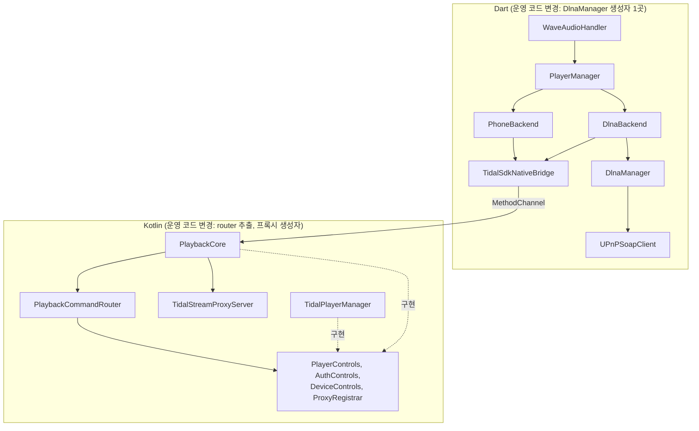

# Application Design (통합)

테스트가 없는 6개 컴포넌트를 자동 테스트로 덮기 위한 대체 지점 설계다. 새 기능 컴포넌트는 없다. 상세는 같은 폴더의 `components.md`, `component-methods.md`, `services.md`, `component-dependency.md` 에 있다.

## 1. 설계 결정

| # | 결정 | 선택 | 운영 코드 변경 |
| --- | --- | --- | --- |
| Q1 | Dart 플랫폼 채널 대체 | 테스트가 MethodChannel 을 가로챈다 (`FakeNativeChannel`). `TidalSdkNativeBridge` 는 그대로 | 없음 |
| Q2 | 백엔드 테스트의 `DlnaManager` | 실제 `DlnaManager` + `FakeSoapClient` | `DlnaManager.forTesting` 에 `soapClient` 매개변수 |
| Q3 | 1초 폴링의 시간 제어 | `fake_async` | 없음 |
| Q4 | Kotlin `PlaybackCore` 테스트 | 명령 분배를 `PlaybackCommandRouter` 로 분리, Robolectric 없음 | `PlaybackCore.kt` 재구성, 새 파일 1 ~ 2개 |
| Q5 | Kotlin 프록시 테스트 | 루프백 임시 포트로 실제 HTTP 왕복, CDN 은 `FakeCdnServer` | 생성자에 `port`, `httpClient` 매개변수 |
| Q6 | fake 위치 | Dart `test/helpers/`, Kotlin 은 테스트와 같은 패키지 | 없음 |

결정 출처: `aidlc-docs/inception/plans/application-design-plan.md` (사용자 지시 "추천으로 진행해줘" 에 따라 모두 권장안).

## 2. 컴포넌트 요약

### 운영 코드

| 컴포넌트 | 변경 |
| --- | --- |
| `PhoneBackend`, `DlnaBackend`, `WaveAudioHandler`, `TidalSdkNativeBridge`, `PlayerManager` | 없음 |
| `DlnaManager` | `forTesting({ssdpService, soapClient})`. 운영 싱글톤 동작 동일 |
| `TidalStreamProxyServer` | 생성자 `(boundHost, port = PROXY_PORT, httpClient = 기존 설정)`. 반환 URL 의 포트를 실제 열린 포트로 |
| `PlaybackCommandRouter` (새로 추가) | `handle(method, args): CommandResult`. 채널 메서드 16개의 분배 · 인자 해석 · 반환 맵 · 오류 변환 |
| `PlayerControls`, `AuthControls`, `DeviceControls`, `ProxyRegistrar`, `CommandResult` (새로 추가) | router 의 협력 인터페이스와 결과 타입 |
| `TidalPlayerManager` | `PlayerControls` 구현 선언만 추가 |
| `PlaybackCore` | `onMethodCall` 이 router 에 위임. 소유 · 연결 · 수명 관리는 그대로 |
| `android/app/build.gradle.kts` | JVM 단위 테스트에서 `android.util.Log` 가 예외를 내지 않게 하는 테스트 설정 |

### 테스트 지원

| 컴포넌트 | 언어 | 대체하는 것 |
| --- | --- | --- |
| `FakeNativeChannel` | Dart | MethodChannel 건너편 |
| `FakeSoapClient` | Dart | `UPnPSoapClient` |
| `FakeSsdpDiscoveryService`, `FakeAuthRepository`, `FakeApiClient`, `FakeBackend` (기존, 확장) | Dart | 탐색, 인증, TIDAL API, 백엔드 |
| `FakeCdnServer` | Kotlin | TIDAL CDN |
| `FakePlayerControls`, `FakeAuthControls`, `FakeDeviceControls`, `FakeProxyRegistrar` | Kotlin | router 협력 객체 |
| `CoverageGate` | `tool/` | - (NFR-01 검사) |

### 새 테스트 파일 6개

`phone_backend_test.dart`, `dlna_backend_test.dart`, `wave_audio_handler_test.dart` (`test/features/player/`), `dlna_manager_test.dart` (`test/features/dlna/`), `TidalStreamProxyServerTest.kt`, `PlaybackCommandRouterTest.kt` (`android/app/src/test/kotlin/com/example/tidal_connect_lite/`).

## 3. 핵심 구조

텍스트 대안: Dart 쪽 구조는 그대로다 (`WaveAudioHandler` → `PlayerManager` → 두 백엔드 → `DlnaManager` · `TidalSdkNativeBridge`). Kotlin 쪽은 `PlaybackCore` 와 협력 객체 사이에 `PlaybackCommandRouter` 와 인터페이스 4개가 들어간다. `PlaybackCore` 는 router 를 만들어 채널 호출을 넘기고, 인터페이스의 실제 구현 (`TidalPlayerManager`, `PlaybackCore` 내부 구현) 을 제공한다.

테스트 경계 (무엇을 실제로 쓰고 무엇을 가짜로 바꾸는지) 와 의존성 매트릭스는 `component-dependency.md` 참조.

## 4. 설계 검증

| 점검 | 결과 |
| --- | --- |
| FR-01 ~ FR-09 가 모두 컴포넌트에 배정됨 | 충족 (`components.md` 5절). FR-08 은 절차라 컴포넌트 없음 |
| 순환 의존 없음 | 충족 (`component-dependency.md` 2절) |
| 메서드가 책임과 맞음 | 충족. router 는 분배만, 소유 · 연결은 `PlaybackCore`, fake 는 기록 · 응답 지정만 |
| 채널 계약 · 프록시 경로 · SOAP 액션 변경 없음 | 충족 |
| `PlayerManager` 단일 출처 원칙 유지 | 충족 (`PlayerManager` 코드 변경 없음) |
| 운영 조립 (`providers.dart`, `main.dart`, `PlaybackCore.attach`) 변경 없음 | 충족 (`services.md` 1절) |

## 5. 설계가 남기는 한계

- `PlaybackCore` 의 Android 연결부 (`attach`, 볼륨 관찰, `requestStreamFromDart`, `requestTokenFromDart`, `ensureProxyServer`, WifiLock) 는 자동 테스트 범위 밖이다 (Q4=A). 이 부분의 회귀는 실기기에서만 드러나는데 실기기 확인은 완료 기준에 없다 (NFR-02)
- `TidalStreamProxyServer.getWifiIpv4Address` (Android `ConnectivityManager`) 도 같은 이유로 범위 밖이다
- TIDAL Player SDK 호출 (`TidalPlayerManager` 내부) 은 테스트하지 않는다
- Dart → 채널 → Kotlin → 프록시를 한 번에 잇는 테스트는 없다. 구간이 만나는 계약 (채널 메서드 · 인자 키, 프록시 URL 형식) 을 양쪽 테스트가 같은 문자열로 검증하는 것으로 대신한다

## 6. 먼저 확인할 기술 위험

| 위험 | 확인 방법 | 안 될 때 |
| --- | --- | --- |
| `fake_async` 안에서 가짜 MethodChannel 응답이 제대로 완료되는지 (Q1=A 와 Q3=A 의 조합) | `DlnaBackend` 테스트의 첫 케이스를 먼저 작성해 확인 | Q3 를 B (폴링 간격 주입) 로 바꾸는 변경 요청 |
| `fake_async` 를 테스트에서 직접 import 하면 린트 (`depend_on_referenced_packages`) 가 걸릴 수 있음 (지금은 flutter_test 를 거친 간접 의존) | NFR Requirements 에서 `dev_dependencies` 추가 여부 결정 | - |
| JVM 단위 테스트에서 `android.util.Log` 호출이 예외를 냄 (`TidalStreamProxyServer` 가 사용) | NFR Requirements 에서 Gradle 테스트 설정 결정 | 로그 호출을 감싸는 작은 래퍼 |

## 7. 코드를 읽으며 본 관찰 사항 (FR-08 후보, 미확인)

아래는 설계 중 코드를 읽다가 본 것으로, 버그인지 아직 확인하지 않았다. 테스트로 재현되면 FR-08 절차 (실패 테스트 → 별도 커밋 → 기록) 를 따른다.

1. **요구사항 FR-05 와 코드 불일치**: `requirements.md` FR-05 는 "CDN URL 없음 400" 을 검증 항목으로 적었지만, `TidalStreamProxyServer.handleAudioRequest` 는 직접 URL 과 매니페스트가 모두 비어 있으면 그 전에 404 를 돌려준다. `proxyDirectCdn` 의 400 분기는 지금 코드에서 도달할 수 없다. Functional Design 에서 이 항목을 "둘 다 비면 404" 로 고치거나 도달 불가 코드를 정리할지 정한다
2. `proxyDirectCdn`: 렌더러가 Range 헤더를 보냈는데 CDN 이 Range 를 무시하고 200 을 주면, 프록시는 `Content-Range` 없이 206 으로 응답한다
3. `headResponse`: 서명 주소가 만료된 상태의 HEAD 요청은 주소를 갱신하지 않고 길이 없는 응답을 준다 (GET 은 갱신 후 재시도)
4. 요구사항 FR-01 의 "네이티브 호출이 실패하면 `PlaybackException`" 은 `play` · `pause` · `resume` 에만 해당한다. `seek` · `stop` · `setNext` · `setAudioQuality` 는 실패해도 예외를 내지 않는다. 의도된 동작인지 Functional Design 에서 정한다

## 8. 확장 규칙 관련

- **Resiliency**: 새 컴포넌트의 중요도 분류는 `components.md` 6절 (RESILIENCY-01). 새 외부 호출 · 저장소 · 배포 구조는 설계하지 않았다. 기존 타임아웃 (SOAP 연결 2초, 프록시 → CDN 20 · 120 · 20초, DLNA 폴링 3회 연속 실패 시 `DLNA_UNREACHABLE`) 은 바꾸지 않는다
- **PBT**: 속성 식별 (PBT-01) 은 unit 별 Functional Design 에서 한다. 이 설계가 정한 순수 로직 경계 (`PlaybackCommandRouter.handle`, `DlnaManager` 의 시간 문자열 변환, `PhoneBackend` 의 이벤트 변환, 프록시 토큰 · URL 생성) 가 속성 테스트 대상 후보다
