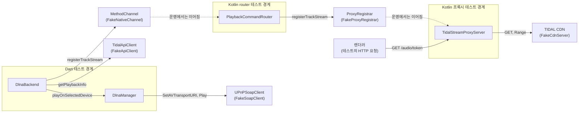
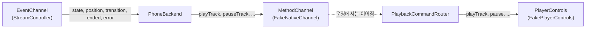

# 컴포넌트 의존성 (Component Dependency)

## 1. 의존성 매트릭스

행이 열에 의존한다. `R` = 운영 의존 (지금도 있음), `N` = 이번에 새로 생기는 운영 의존, `T` = 테스트에서만 생기는 의존.

### Dart

| 의존하는 쪽 ↓ / 대상 → | `PlayerManager` | `DlnaManager` | `TidalSdkNativeBridge` | `UPnPSoapClient` | `SSDPDiscoveryService` | `TidalAuthRepository` | `TidalApiClient` |
| --- | --- | --- | --- | --- | --- | --- | --- |
| `WaveAudioHandler` | R | R | - | - | - | - | - |
| `PlayerManager` | - | R | R | - | - | R | R |
| `PhoneBackend` | - | - | R | - | - | - | - |
| `DlnaBackend` | - | R | R | - | - | R | R |
| `DlnaManager` | - | - | - | R | R | - | - |

Dart 운영 코드에 새 의존은 없다. `DlnaManager` 가 `UPnPSoapClient` 를 받는 방식만 바뀐다 (내부 생성 → 생성자 초기화).

### Kotlin

| 의존하는 쪽 ↓ / 대상 → | `PlaybackCommandRouter` | 협력 인터페이스 | `TidalPlayerManager` | `TidalAuthManager` | `TidalStreamProxyServer` | `DashManifest` · `DashSegmentInputStream` |
| --- | --- | --- | --- | --- | --- | --- |
| `PlaybackCore` | N | N (구현) | R | R | R | - |
| `PlaybackCommandRouter` | - | N | - | - | - | - |
| `TidalPlayerManager` | - | N (`PlayerControls` 구현) | - | - | - | - |
| `TidalStreamProxyServer` | - | - | - | - | - | R |

`PlaybackCommandRouter` 는 인터페이스에만 의존하고 `PlaybackCore`, Android, Flutter 타입을 모른다. 의존 방향은 `PlaybackCore` → router → 인터페이스 ← `PlaybackCore` 의 구현 · `TidalPlayerManager` 이다.

### 테스트 지원 컴포넌트

| 테스트 · fake ↓ / 대상 → | 대체하는 것 | 의존 |
| --- | --- | --- |
| `FakeNativeChannel` | MethodChannel 건너편 (Kotlin) | Flutter 테스트 바인딩 (T) |
| `FakeSoapClient` | `UPnPSoapClient` | 상속 (T) |
| `FakeSsdpDiscoveryService` | `SSDPDiscoveryService` | 상속 (T) |
| `FakeAuthRepository`, `FakeApiClient` | `TidalAuthRepository`, `TidalApiClient` | 상속 (T) |
| `FakeBackend` | `PlaybackBackend` | 구현 (T) |
| `FakeCdnServer` | TIDAL CDN | 없음 (독립 로컬 서버) |
| Kotlin fake 4개 | 협력 인터페이스 | 구현 (T) |
| `CoverageGate` | - | `coverage/lcov.info` 파일 형식 |

## 2. 순환 의존 확인

- Dart: 위 매트릭스에 순환 없음. `PlayerManager` ↔ `DlnaManager` 는 `DlnaManager.isPlaybackActive` 콜백 (함수 주입) 으로 이어져 있어 타입 의존은 한 방향 (`PlayerManager` → `DlnaManager`) 이다. 이번에 바꾸지 않는다
- Kotlin: `PlaybackCore` → `PlaybackCommandRouter` → 인터페이스. 인터페이스의 운영 구현이 `PlaybackCore` 안에 있지만 router 는 구현을 모르므로 순환이 아니다 (의존성 역전)
- 테스트 지원 컴포넌트끼리의 의존 없음

## 3. 통신 방식

| 구간 | 방식 | 테스트에서 |
| --- | --- | --- |
| Dart → Kotlin 명령 | MethodChannel `com.example.tidal_connect_lite/tidal_sdk` (비동기 요청 · 응답) | Dart 쪽: `FakeNativeChannel` 이 가로챔 / Kotlin 쪽: `PlaybackCommandRouter.handle` 직접 호출 |
| Kotlin → Dart 요청 (`refreshUserToken`, `refreshTrackStream`) | 같은 MethodChannel 의 역방향 호출 | Dart 쪽: `FakeNativeChannel.invokeFromNative` / Kotlin 쪽: 테스트 범위 밖 (`PlaybackCore` 연결부) |
| Kotlin → Dart 이벤트 | EventChannel `player_events` (스트림) | Dart 쪽: `PhoneBackend(nativeEvents:)` 에 `StreamController` 주입 |
| 백엔드 → `PlayerManager` | `Stream<BackendEvent>` | 테스트가 `backend.events` 를 직접 구독 |
| `DlnaManager` → 렌더러 | UPnP SOAP (HTTP POST) | `FakeSoapClient` 가 대체 (HTTP 수준은 기존 `upnp_soap_client_test.dart` 가 검증) |
| `DlnaBackend` → 렌더러 상태 | 1초 주기 폴링 (`Timer.periodic`) | `fake_async` 로 시간 진행 |
| 렌더러 → 프록시 | HTTP GET · HEAD (`/audio/{token}.{ext}`, `/ping`) | 테스트가 루프백으로 실제 HTTP 요청 |
| 프록시 → TIDAL CDN | HTTP GET · HEAD (OkHttp) | `FakeCdnServer` 가 대체 |
| `PlayerManager` → `WaveAudioHandler` | `ValueNotifier` 구독 | 실제 `PlayerManager` 사용, fake 백엔드 이벤트로 상태 변경 |

채널 계약은 Dart 테스트 (`FakeNativeChannel` 이 받은 메서드 이름 · 인자 키) 와 Kotlin 테스트 (`PlaybackCommandRouter` 가 읽는 메서드 이름 · 인자 키) 가 양쪽에서 같은 문자열을 검증한다. 문자열 표는 `aidlc-docs/inception/reverse-engineering/api-documentation.md` C절이 기준이다.

## 4. 데이터 흐름

### DLNA 재생 경로와 테스트 경계

텍스트 대안: 운영에서는 `DlnaBackend` → MethodChannel → `PlaybackCore` (`PlaybackCommandRouter`) → `TidalStreamProxyServer` 로 이어지고, 렌더러가 프록시에 HTTP 요청을 보내면 프록시가 TIDAL CDN 에서 받아 전달한다. 테스트는 이 경로를 세 구간으로 나눈다: (1) Dart 구간은 `DlnaBackend` · `DlnaManager` 를 실제로 쓰고 API · 채널 · SOAP 을 가짜로 바꾼다. (2) router 구간은 `PlaybackCommandRouter` 를 실제로 쓰고 프록시 등록을 가짜로 바꾼다. (3) 프록시 구간은 `TidalStreamProxyServer` 를 실제로 띄우고 렌더러 요청은 테스트가, CDN 은 `FakeCdnServer` 가 맡는다.

구간이 만나는 곳 (채널 계약, `registerTrackStream` 의 인자와 반환 URL 형식) 은 양쪽 테스트가 같은 값을 쓰는지로 확인한다. 세 구간을 한 번에 잇는 테스트는 실기기가 필요해 범위 밖이다 (NFR-02).

### 폰 재생 경로와 테스트 경계

텍스트 대안: `PhoneBackend` 는 명령을 MethodChannel 로 보내고 이벤트를 EventChannel 로 받는다. Dart 테스트는 채널을 `FakeNativeChannel` 로, 이벤트를 `StreamController` 로 바꾼다. Kotlin 테스트는 `PlaybackCommandRouter` 에 같은 메서드 이름을 넣고 `FakePlayerControls` 호출을 확인한다. TIDAL Player SDK 자체 (`TidalPlayerManager` 내부) 는 테스트하지 않는다.

## 5. 변경 순서에 주는 영향

| 순서 | 내용 | 이유 |
| --- | --- | --- |
| 1 | `DlnaManager.forTesting(soapClient:)`, `FakeSoapClient`, `FakeNativeChannel`, 기존 fake 확장 | `DlnaBackend` · `WaveAudioHandler` · `DlnaManager` 테스트의 공통 선행 조건 |
| 2 | `DlnaManager`, `PhoneBackend`, `DlnaBackend`, `WaveAudioHandler` 테스트 | 1에 의존. 서로는 독립 |
| 3 | Kotlin: 인터페이스 → `PlaybackCommandRouter` → `PlaybackCore` 위임, `TidalStreamProxyServer` 매개변수 | Dart 와 독립. router 추출은 `PlaybackCore` 변경보다 먼저 |
| 4 | `CoverageGate`, `tool/check.sh`, `check.yml` | 2가 끝나 80% 를 넘은 뒤 |
