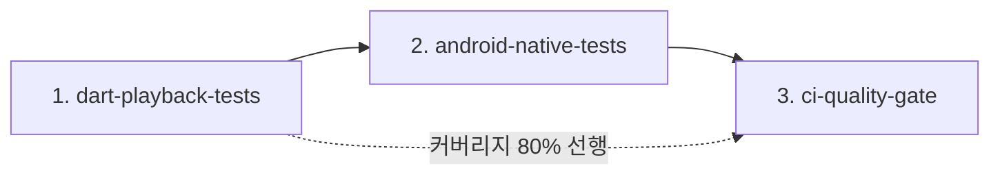

# Unit of Work 의존성 (Unit of Work Dependency)

## 의존성 매트릭스

행이 열에 의존한다.

| 의존하는 unit ↓ / 대상 → | `dart-playback-tests` | `android-native-tests` | `ci-quality-gate` |
| --- | --- | --- | --- |
| `dart-playback-tests` | - | 없음 | 없음 |
| `android-native-tests` | 없음 | - | 없음 |
| `ci-quality-gate` | 있음 (선행 필수) | 있음 (약함) | - |

| 의존 | 유형 | 이유 |
| --- | --- | --- |
| `ci-quality-gate` → `dart-playback-tests` | 선행 필수 | 커버리지 검사는 대상 4개 파일이 80% 를 넘은 뒤에 켜야 한다. 먼저 켜면 `tool/check.sh` 와 CI 가 실패한다 |
| `ci-quality-gate` → `android-native-tests` | 약함 | `tool/check.sh` 는 이미 Kotlin 단위 테스트를 실행한다. unit 2 가 끝나 있어야 unit 3 의 "`tool/check.sh` 전체 통과" 가 최종 상태를 확인한다. APK 빌드 단계도 unit 2 의 `PlaybackCore` 재구성이 들어간 코드를 빌드한다 |

순환 의존 없음.

## 진행 순서

텍스트 대안: `dart-playback-tests` → `android-native-tests` → `ci-quality-gate` 순서로 진행한다. unit 1 과 unit 2 는 서로 의존하지 않아 순서를 바꿀 수 있지만, 계획 Q2=A 에 따라 Dart 를 먼저 한다. unit 3 은 unit 1 (필수) 과 unit 2 뒤에 온다.

의존하는 unit (`ci-quality-gate`) 이 의존 대상보다 뒤에 온다.

## 공유 자원과 조율 지점

| 자원 | 관련 unit | 조율 방식 |
| --- | --- | --- |
| 채널 계약 (MethodChannel 메서드 이름 · 인자 키 · 반환 맵) | unit 1 (Dart 쪽에서 보내는 값 검증), unit 2 (Kotlin 쪽에서 읽는 값 검증) | 코드 의존은 없다. 두 unit 의 테스트가 `aidlc-docs/inception/reverse-engineering/api-documentation.md` C절의 같은 문자열을 쓴다. unit 2 의 Functional Design 에서 unit 1 의 테스트가 쓴 문자열과 대조한다 |
| 프록시 URL 형식 (`http://<host>:<port>/audio/<token>.<ext>`) | unit 1 (`DlnaBackend` 가 받은 URL 을 SOAP 으로 전달), unit 2 (프록시가 URL 생성) | unit 1 은 URL 을 불투명한 문자열로 다루므로 형식에 의존하지 않는다 |
| `tool/check.sh` | unit 3 만 수정 | unit 1 · 2 는 수정하지 않고 실행만 한다 |
| `pubspec.yaml` | unit 1 만 수정 | - |
| `android/app/build.gradle.kts` | unit 2 만 수정 | - |
| `test/helpers/` | unit 1 만 수정 | 기존 fake 의 기본 동작을 유지해 기존 테스트에 영향이 없게 한다 |

같은 파일을 두 unit 이 수정하는 경우는 없다.

## 통합 확인 시점

| 시점 | 확인 |
| --- | --- |
| unit 1 끝 | `tool/check.sh --skip-android`, 대상 4개 파일 커버리지 수동 측정 |
| unit 2 끝 | Kotlin 단위 테스트, `flutter build apk --debug` |
| unit 3 끝 | `tool/check.sh` 전체 (커버리지 검사 포함) |
| Build and Test | 전체 점검, 10회 반복 실행, 실행 시간 측정 |

## 롤백

unit 마다, 그리고 unit 안에서도 단계마다 커밋을 나눈다. 문제가 생기면 해당 커밋만 `git revert` 한다 (요구사항의 롤백 결정). unit 3 을 되돌려도 unit 1 · 2 의 테스트는 남는다.
