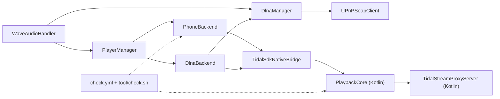

# 실행 계획 (Execution Plan)

## 상세 분석 요약

### 변환 범위 (Brownfield 전용)
- **변환 유형**: Multiple components (아키텍처 변환 아님, 인프라 변경 없음)
- **주요 변경**: 테스트가 없는 6개 컴포넌트에 자동 테스트 추가 (FR-01 ~ FR-06), 테스트를 위한 대체 지점 추가 (FR-07), 발견 버그 수정 (FR-08), CI 에 커버리지 검사와 APK 산출물 업로드 추가 (FR-09)
- **관련 컴포넌트**: `PhoneBackend`, `DlnaBackend`, `DlnaManager`, `WaveAudioHandler`, `TidalSdkNativeBridge` (Dart) / `TidalStreamProxyServer`, `PlaybackCore` (Kotlin) / `.github/workflows/check.yml`, `tool/check.sh`, `pubspec.yaml`, `android/app/build.gradle.kts`

### 변경 영향 평가
- **사용자에게 보이는 변경**: No - 화면과 재생 동작은 그대로다. 예외: FR-08 로 버그를 고치면 그 버그의 증상이 사라진다
- **구조 변경**: Yes (작음) - 싱글톤 · 정적 호출 · 타이머에 주입 지점을 추가한다. `PlayerManager` 단일 출처 구조와 두 백엔드 인터페이스는 유지한다
- **데이터 모델 변경**: No
- **API 변경**: No - MethodChannel · EventChannel 계약, 프록시 HTTP 경로, SOAP 액션은 바꾸지 않는다. 생성자에 선택 매개변수가 늘 수 있다 (기본값은 기존 동작)
- **NFR 영향**: Yes - 테스트 커버리지 (NFR-01), 테스트 결정성 · 속도 (NFR-03), PBT (NFR-04). 실행 성능 · 보안에는 영향 없음

### 컴포넌트 관계 (Brownfield 전용)

텍스트 대안: `WaveAudioHandler` 는 `PlayerManager` 와 `DlnaManager` 에 의존한다. `PlayerManager` 는 `PhoneBackend` 와 `DlnaBackend` 를 쓴다. `PhoneBackend` 와 `DlnaBackend` 는 `TidalSdkNativeBridge` (플랫폼 채널) 를 호출하고, `DlnaBackend` 는 `DlnaManager` 도 쓴다. `DlnaManager` 는 `UPnPSoapClient` 를 쓴다. 채널 건너편에서 `PlaybackCore` 가 `TidalStreamProxyServer` 를 소유한다. CI 는 Dart 와 Kotlin 테스트를 모두 실행한다.

| 컴포넌트 | 역할 | 변경 유형 | 변경 이유 | 우선순위 |
| --- | --- | --- | --- | --- |
| `DlnaManager` | 주 컴포넌트 | Minor | 싱글톤에 SOAP · 탐색 · 저장소 주입 지점 추가, 테스트 추가 | Critical (`DlnaBackend`, `WaveAudioHandler` 테스트가 의존) |
| `TidalSdkNativeBridge` | 공유 컴포넌트 | Minor | 정적 채널 호출을 테스트에서 대체할 방법 필요 | Critical (두 백엔드 테스트가 의존) |
| `PhoneBackend`, `DlnaBackend` | 주 컴포넌트 | Minor | 주입 지점 · 타이머 제어, 테스트 추가 | Critical |
| `WaveAudioHandler` | 주 컴포넌트 | Minor | 테스트 추가 (이미 `dlnaManager` 주입 가능) | Important |
| `TidalStreamProxyServer` | 주 컴포넌트 | Minor | 포트 · 업스트림 호출 대체 지점, 테스트 추가 | Critical |
| `PlaybackCore` | 주 컴포넌트 | Minor | `object` 가 소유한 SDK · 프록시 대체 지점, 테스트 추가 | Critical |
| `PlayerManager` | 의존 컴포넌트 | 변경 없음 (예상) | 백엔드를 호출하는 쪽, 기존 테스트로 회귀 확인 | - |
| CI (`check.yml`, `tool/check.sh`) | 지원 컴포넌트 | Configuration-only | 커버리지 검사, APK 산출물 업로드 | Important |
| 인프라 컴포넌트 | - | 없음 | IaC · 서버 없음 | - |

### 위험 평가
- **위험 수준**: Medium - 재생 핵심 경로의 운영 코드에 주입 지점을 넣는데, 실기기 확인이 완료 기준에서 빠져 있다 (NFR-02). 기기에서만 드러나는 회귀를 자동 테스트가 놓칠 수 있다
- **위험 완화**: 주입 지점은 기본값이 기존 동작인 선택 매개변수로만 추가하고, 기존 95개 테스트를 회귀 확인에 쓴다. 채널 계약 문자열은 바꾸지 않는다
- **롤백 복잡도**: Easy - `git revert` 후 다시 빌드 · 설치 (요구사항의 롤백 결정)
- **테스트 복잡도**: Complex - 플랫폼 채널, 주기 타이머, 로컬 HTTP 서버, 프로세스 범위 `object`, 두 언어의 PBT

## 워크플로우 시각화

```mermaid
flowchart TD
    Start(["사용자 요청"])

    subgraph INCEPTION["🔵 INCEPTION PHASE"]
        WD["Workspace Detection<br/><b>COMPLETED</b>"]
        RE["Reverse Engineering<br/><b>COMPLETED</b>"]
        RA["Requirements Analysis<br/><b>COMPLETED</b>"]
        US["User Stories<br/><b>SKIP</b>"]
        WP["Workflow Planning<br/><b>COMPLETED</b>"]
        AD["Application Design<br/><b>EXECUTE</b>"]
        UG["Units Generation<br/>(Planning + Generation)<br/><b>EXECUTE</b>"]
    end

    subgraph CONSTRUCTION["🟢 CONSTRUCTION PHASE"]
        FD["Functional Design<br/><b>EXECUTE</b>"]
        NFRA["NFR Requirements<br/><b>EXECUTE</b>"]
        NFRD["NFR Design<br/><b>EXECUTE</b>"]
        ID["Infrastructure Design<br/><b>SKIP</b>"]
        CG["Code Generation<br/>(Planning + Generation)<br/><b>EXECUTE</b>"]
        BT["Build and Test<br/><b>EXECUTE</b>"]
    end

    subgraph OPERATIONS["🟡 OPERATIONS PHASE"]
        DPL["Deployment Pipeline<br/><b>SKIP</b>"]
        ENV["Environment Provisioning<br/><b>SKIP</b>"]
        DEX["Deployment Execution<br/><b>SKIP</b>"]
        OBS["Observability Setup<br/><b>SKIP</b>"]
        INC["Incident Response<br/><b>SKIP</b>"]
        PERF["Performance Validation<br/><b>SKIP</b>"]
        FBO["Feedback & Optimization<br/><b>SKIP</b>"]
    end

    Start --> WD
    WD --> RE
    RE --> RA
    RA --> WP
    WP --> AD
    AD --> UG
    UG --> FD
    FD --> NFRA
    NFRA --> NFRD
    NFRD --> CG
    CG -->|"다음 unit"| FD
    CG --> BT
    BT --> End(["완료"])

    style WD fill:#4CAF50,stroke:#1B5E20,stroke-width:3px,color:#fff
    style RE fill:#4CAF50,stroke:#1B5E20,stroke-width:3px,color:#fff
    style RA fill:#4CAF50,stroke:#1B5E20,stroke-width:3px,color:#fff
    style WP fill:#4CAF50,stroke:#1B5E20,stroke-width:3px,color:#fff
    style CG fill:#4CAF50,stroke:#1B5E20,stroke-width:3px,color:#fff
    style BT fill:#4CAF50,stroke:#1B5E20,stroke-width:3px,color:#fff
    style AD fill:#FFA726,stroke:#E65100,stroke-width:3px,stroke-dasharray: 5 5,color:#000
    style UG fill:#FFA726,stroke:#E65100,stroke-width:3px,stroke-dasharray: 5 5,color:#000
    style FD fill:#FFA726,stroke:#E65100,stroke-width:3px,stroke-dasharray: 5 5,color:#000
    style NFRA fill:#FFA726,stroke:#E65100,stroke-width:3px,stroke-dasharray: 5 5,color:#000
    style NFRD fill:#FFA726,stroke:#E65100,stroke-width:3px,stroke-dasharray: 5 5,color:#000
    style US fill:#BDBDBD,stroke:#424242,stroke-width:2px,stroke-dasharray: 5 5,color:#000
    style ID fill:#BDBDBD,stroke:#424242,stroke-width:2px,stroke-dasharray: 5 5,color:#000
    style DPL fill:#BDBDBD,stroke:#424242,stroke-width:2px,stroke-dasharray: 5 5,color:#000
    style ENV fill:#BDBDBD,stroke:#424242,stroke-width:2px,stroke-dasharray: 5 5,color:#000
    style DEX fill:#BDBDBD,stroke:#424242,stroke-width:2px,stroke-dasharray: 5 5,color:#000
    style OBS fill:#BDBDBD,stroke:#424242,stroke-width:2px,stroke-dasharray: 5 5,color:#000
    style INC fill:#BDBDBD,stroke:#424242,stroke-width:2px,stroke-dasharray: 5 5,color:#000
    style PERF fill:#BDBDBD,stroke:#424242,stroke-width:2px,stroke-dasharray: 5 5,color:#000
    style FBO fill:#BDBDBD,stroke:#424242,stroke-width:2px,stroke-dasharray: 5 5,color:#000
    style Start fill:#CE93D8,stroke:#6A1B9A,stroke-width:3px,color:#000
    style End fill:#CE93D8,stroke:#6A1B9A,stroke-width:3px,color:#000
    style INCEPTION fill:#BBDEFB,stroke:#1565C0,color:#000
    style CONSTRUCTION fill:#C8E6C9,stroke:#2E7D32,color:#000
    style OPERATIONS fill:#FFF59D,stroke:#F9A825,color:#000

    linkStyle default stroke:#333,stroke-width:2px
```

텍스트 대안: Workspace Detection → Reverse Engineering → Requirements Analysis → Workflow Planning (여기까지 완료, User Stories 는 SKIP) → Application Design → Units Generation → unit 마다 [Functional Design → NFR Requirements → NFR Design → Code Generation] 반복 (Infrastructure Design 은 SKIP) → Build and Test → 완료. Operations 7개 stage 는 모두 SKIP.

## 실행할 Phase

### 🔵 INCEPTION PHASE
- [x] Workspace Detection (COMPLETED)
- [x] Reverse Engineering (COMPLETED)
- [x] Requirements Analysis (COMPLETED)
- [x] User Stories (SKIPPED)
  - **근거 (Rationale)**: 사용자에게 보이는 변화가 없는 테스트 보강이다. persona 가 1명 (개인 사용자) 이고 인수 조건은 FR · NFR 의 측정 기준으로 충분하다
- [x] Execution Plan (IN PROGRESS)
- [ ] Application Design - EXECUTE (Minimal 깊이)
  - **근거 (Rationale)**: FR-07 의 대체 지점 (채널 대체 방식, `DlnaManager` 싱글톤 주입, 시계 · 타이머 주입, `PlaybackCore` · 프록시의 협력 객체 분리) 은 여러 컴포넌트에 걸친 의존성 결정이다. 6개 컴포넌트가 같은 방식을 쓰도록 먼저 정한다. Units Generation 의 필수 선행 stage 이기도 하다
- [ ] Units Generation - EXECUTE
  - **근거 (Rationale)**: Dart, Kotlin, CI 설정이라는 서로 다른 패키지를 바꾼다. 언어마다 테스트 도구와 PBT 프레임워크가 다르고, Dart 안에서도 의존 순서 (`DlnaManager` · 채널 대체 → 백엔드 → `WaveAudioHandler`) 가 있다. CI 커버리지 검사는 테스트가 들어온 뒤에만 통과하므로 순서 구분이 필요하다

### 🟢 CONSTRUCTION PHASE
unit 별 확정 (Units Generation, 2026-11-17): `dart-playback-tests` 와 `android-native-tests` 는 Functional Design · NFR Requirements · NFR Design · Code Generation 실행. `ci-quality-gate` 는 NFR Requirements · Code Generation 만 실행하고 Functional Design · NFR Design 은 SKIP. 상세는 `aidlc-docs/inception/application-design/unit-of-work.md`.
- [ ] Functional Design - EXECUTE (unit 별, 로직이 있는 unit 만)
  - **근거 (Rationale)**: PBT 확장 (PBT-01) 이 변환 · 상태 로직을 가진 unit 마다 이 stage 에서 속성을 식별하도록 강제한다 (이벤트 변환, 폴링 상태 기계, 시간 문자열 변환, 프록시 토큰 · 접근 제어). CI 설정 unit 은 로직이 없어 SKIP 예상 (Units Generation 뒤 unit 별로 확정)
- [ ] NFR Requirements - EXECUTE (unit 별)
  - **근거 (Rationale)**: PBT-09 가 언어마다 PBT 프레임워크 선택을 이 stage 에서 요구한다. 커버리지 측정 · 검사 도구, 가짜 시계 등 테스트 기술 스택도 여기서 정한다
- [ ] NFR Design - EXECUTE (unit 별)
  - **근거 (Rationale)**: NFR Requirements 를 실행하므로 그 결정을 패턴으로 옮긴다 (결정적 테스트 패턴, fake 구성, 임시 포트). 복원력 확장의 RESILIENCY-14 질문 (복원력 테스트 방식) 과 RESILIENCY-15 의 가벼운 장애 대응 · COE 제안도 여기서 다룬다
- [ ] Infrastructure Design - SKIP
  - **근거 (Rationale)**: 서버 · 클라우드 인프라가 없고 배포 구조도 바뀌지 않는다. CI 변경은 설정 파일 수정이라 Code Generation 에서 다룬다
- [ ] Code Generation - EXECUTE (ALWAYS)
  - **근거 (Rationale)**: 구현 계획과 코드 생성 필요
- [ ] Build and Test - EXECUTE (ALWAYS)
  - **근거 (Rationale)**: 빌드, 테스트, 검증 필요

### 🟡 OPERATIONS PHASE
- [ ] Deployment Pipeline - SKIP
  - **근거 (Rationale)**: 배포 대상이 본인 기기 1대이고 APK 를 직접 설치한다. 배포 방식 (direct) 과 롤백 (`git revert`) 은 요구사항에서 이미 정했다. CI 의 APK 빌드 · 산출물 업로드 (FR-09) 는 기존 workflow 파일 수정이라 Code Generation 에서 다룬다
- [ ] Environment Provisioning - SKIP
  - **근거 (Rationale)**: 준비할 서버 환경 없음
- [ ] Deployment Execution - SKIP
  - **근거 (Rationale)**: 실기기 설치 · 확인은 완료 기준에서 제외 (NFR-02)
- [ ] Observability Setup - SKIP
  - **근거 (Rationale)**: 운영되는 서비스 없음 (기기 앱)
- [ ] Incident Response - SKIP
  - **근거 (Rationale)**: 운영 서비스 없음. RESILIENCY-15 의 가벼운 COE 제안은 NFR Design 에서 작성
- [ ] Performance Validation - SKIP
  - **근거 (Rationale)**: 성능 · 확장성 NFR 없음 (테스트 실행 시간 NFR-03 은 Build and Test 에서 확인)
- [ ] Feedback & Optimization - SKIP
  - **근거 (Rationale)**: 운영 데이터 없음

## 패키지 변경 순서 (Brownfield 전용)

### 모듈 업데이트 전략
- **업데이트 방식**: Hybrid (Dart 안은 순차, Dart 와 Kotlin 은 서로 독립, CI 는 마지막)
- **Critical Path**: Dart 의 공용 대체 지점 (`TidalSdkNativeBridge` 대체, `DlnaManager` 주입) → 이것이 없으면 두 백엔드와 `WaveAudioHandler` 테스트를 쓸 수 없다
- **조율 지점**: MethodChannel · EventChannel 계약 문자열 (Dart 와 Kotlin 이 같은 이름을 써야 하므로 바꾸지 않는다), `tool/check.sh` 와 `check.yml` 의 점검 내용 일치
- **테스트 체크포인트**: 단계마다 `tool/check.sh --skip-android` (Dart) 또는 Kotlin 단위 테스트, 마지막에 `tool/check.sh` 전체

### 순서 (unit 구성은 Units Generation 에서 확정)
1. Dart 공용 대체 지점 + `DlnaManager` 테스트 - 다른 Dart 테스트의 선행 조건
2. `PhoneBackend`, `DlnaBackend` 테스트 - 1의 대체 지점 사용
3. `WaveAudioHandler` 테스트 - `DlnaManager` fake 사용
4. Kotlin `TidalStreamProxyServer`, `PlaybackCore` 테스트 - Dart 와 독립, 1 ~ 3 과 순서 무관
5. CI 커버리지 검사 + APK 산출물 업로드 - 1 ~ 3 이 끝나 80% 를 넘은 뒤에 켜야 CI 가 깨지지 않는다

롤백: 단계마다 커밋을 나누므로 실패한 단계만 `git revert` 한다.

## 예상 일정
- **전체 Phase 수**: 실행 11개 stage (완료 4 + 남은 7), SKIP 9개
- **예상 소요 기간**: 남은 stage 는 unit 수에 따라 승인 관문이 늘어난다. unit 3개 기준으로 Inception 2개 관문, unit 당 설계 3개 + 코드 2개 (계획 · 결과) 관문, Build and Test 1개 관문

## 성공 기준
- **주 목표**: 테스트가 없던 6개 컴포넌트의 공개 동작과 오류 경로를 자동 테스트로 검증한다
- **핵심 결과물**: 새 Dart · Kotlin 테스트 (예시 기반 + PBT), 테스트용 fake · 대체 지점, 커버리지 검사와 APK 산출물 업로드가 들어간 CI, 발견 버그의 수정 기록
- **품질 게이트**:
  - Dart 대상 4개 파일 각각 라인 커버리지 80% 이상 (NFR-01)
  - `tool/check.sh` 전체 통과, CI 통과 (NFR-02)
  - 10회 연속 실행 flaky 0건, 추가 실행 시간 30초 이하 (NFR-03)
  - PBT 규칙 준수 (NFR-04)
- **통합 테스트**: 기존 95개 테스트가 그대로 통과해 주입 지점 추가로 인한 회귀가 없음을 확인
- **운영 준비**: 해당 없음 (운영 서비스 없음). 실기기 확인은 범위 밖
