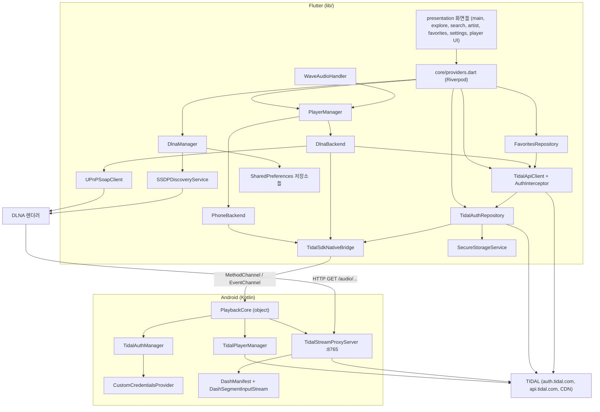
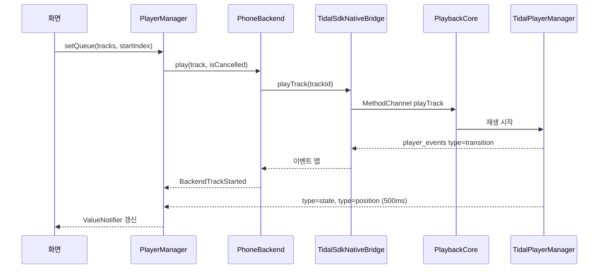
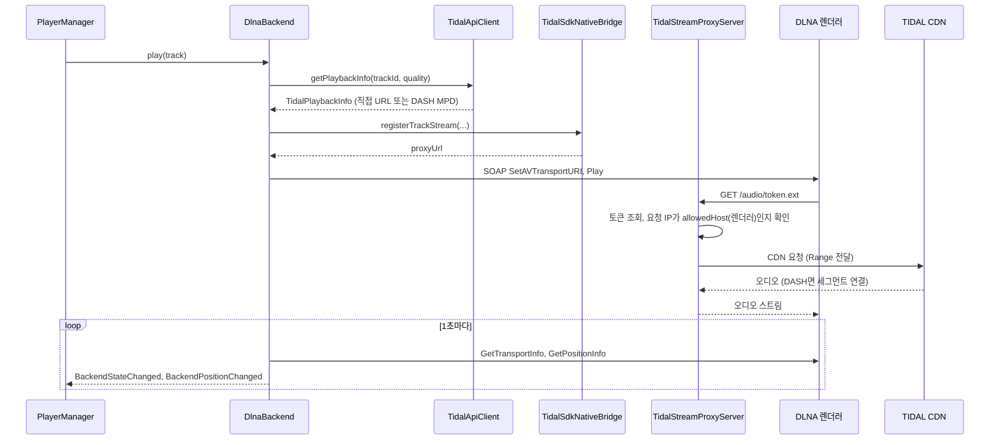
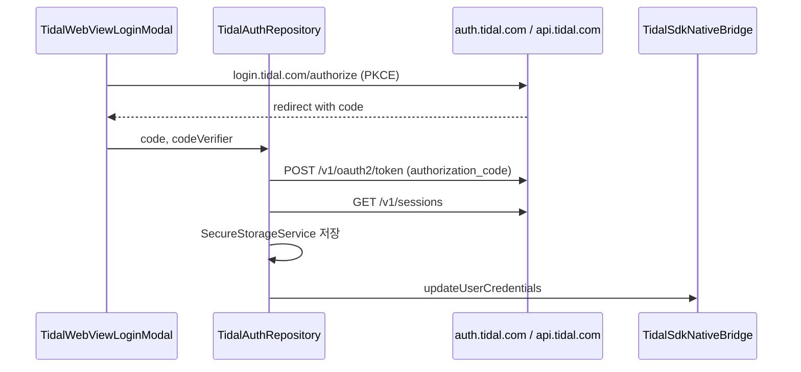

# 시스템 아키텍처 (System Architecture)

## 시스템 개요
단일 Flutter 애플리케이션(Dart, `lib/`)과 그 Android 호스트(Kotlin, `android/app/src/main/kotlin/com/example/tidal_connect_lite/`)로 이루어진 모바일 앱이다. 서버·백엔드·IaC는 없다. 기능별 폴더(`lib/features/<feature>/{data,domain,presentation}`)와 공용 `lib/core/`로 나뉘고, Riverpod `Provider`(`lib/core/providers.dart`)가 서비스를 연결한다.

재생 상태의 단일 출처는 `PlayerManager`(`lib/features/player/data/player_manager.dart`, 싱글톤 `PlayerManager.instance`)다. 화면은 `PlayerManager`가 노출하는 `ValueNotifier`들(`currentTrackNotifier`, `isPlayingNotifier`, `progressSecondsNotifier` 등)을 구독하고, 상태는 출력 백엔드(`PlaybackBackend`)가 보내는 `BackendEvent`로 갱신된다. 백엔드는 두 개다.
- `PhoneBackend`: MethodChannel `com.example.tidal_connect_lite/tidal_sdk` → Kotlin `PlaybackCore` → `TidalPlayerManager`(TIDAL Player SDK). 이벤트는 EventChannel `com.example.tidal_connect_lite/player_events`로 돌아온다.
- `DlnaBackend`: `UPnPSoapClient`로 렌더러를 제어하고, 오디오 URL은 Kotlin `TidalStreamProxyServer`(NanoHTTPD, 포트 8765)가 만든 단축 URL을 쓴다. 상태는 1초 주기 폴링(`GetTransportInfo`/`GetPositionInfo`)으로 얻는다.

`PlaybackCore`는 Kotlin `object`(프로세스 범위)로 인증 관리자, 플레이어, 프록시 서버를 소유하며 `MainActivity`에 묶이지 않는다. `WaveAudioHandler`(audio_service)는 잠금화면·알림·블루투스 명령을 `PlayerManager`로 전달한다.

## 아키텍처 도식

### 텍스트 대안
- 화면 -> Riverpod Provider -> PlayerManager / TidalAuthRepository / TidalApiClient / FavoritesRepository / DlnaManager
- WaveAudioHandler -> PlayerManager
- PlayerManager -> PhoneBackend -> TidalSdkNativeBridge -> (MethodChannel) -> PlaybackCore -> TidalPlayerManager -> TIDAL
- PlayerManager -> DlnaBackend -> TidalApiClient(재생 정보) + TidalSdkNativeBridge(registerTrackStream) + UPnPSoapClient -> 렌더러
- 렌더러 -> TidalStreamProxyServer(:8765) -> TIDAL CDN (DASH면 DashManifest/DashSegmentInputStream으로 이어 붙임)
- PlaybackCore -> TidalAuthManager -> CustomCredentialsProvider (토큰 갱신은 Dart `refreshUserToken` 호출)
- DlnaManager -> SSDPDiscoveryService, 선택 기기는 SharedPreferences에 저장

## 컴포넌트 설명
### main
- **목적**: 앱 진입점과 최상위 화면
- **책임**: `lib/main.dart`에서 `ProviderContainer` 생성, `initNativeSdk()`, `PlayerManager.configure(...)`, 음질 설정 적용, 최근 재생 연결, `AudioService.init`, `runApp`. `SplashScreen`(자동 로그인), `MainScreen`(탭 내비게이션)
- **의존성**: core, auth, player, dlna, settings
- **유형**: Application

### core
- **목적**: 공용 기반 코드
- **책임**: Riverpod Provider 정의(`providers.dart`), `TidalConfig`(dart-define 키), `TidalSdkNativeBridge`(채널 래퍼), 테마, `AppLogger`, `Paginator`, 공용 위젯(`TrackTile`, `FavoriteButton`, `QualityBadge` 등)
- **의존성**: flutter_riverpod, Flutter services(MethodChannel)
- **유형**: Model/Client (공용)

### auth
- **목적**: TIDAL 인증
- **책임**: `TidalAuthRepository`(client_credentials 카탈로그 토큰, authorization_code+PKCE 교환, refresh, `/sessions`, 로그아웃), `TidalPkceAuth`, `SecureStorageService`, `AuthToken`, `TidalWebViewLoginModal`
- **의존성**: dio, flutter_secure_storage, crypto, webview_flutter, core(`TidalSdkNativeBridge`)
- **유형**: Application

### tidal_api
- **목적**: TIDAL REST v1 클라이언트
- **책임**: `TidalApiClient`(카탈로그, 검색, 즐겨찾기, 재생 정보), `AuthInterceptor`(토큰 첨부와 401 복구), `ApiFailure`, 도메인 모델 `MediaTrack`/`MediaAlbum`/`MediaPlaylist`/`MediaArtist`
- **의존성**: dio, auth
- **유형**: Client

### player
- **목적**: 재생 제어와 상태 관리
- **책임**: `PlayerManager`, `PlayQueue`, `PlaybackBackend`/`PhoneBackend`/`DlnaBackend`, `WaveAudioHandler`, `RecentlyPlayedStore`, 재생 화면(`NowPlayingScreen`, `MiniPlayerWidget`, `SpeakerSelectorModal`)
- **의존성**: tidal_api, auth, dlna, core, audio_service, shared_preferences
- **유형**: Application

### dlna
- **목적**: 네트워크 렌더러 탐색과 제어
- **책임**: `SSDPDiscoveryService`(M-SEARCH, 기기 설명 XML 해석), `DlnaManager`(싱글톤, 선택 기기 저장·복원), `UPnPSoapClient`(AVTransport/RenderingControl SOAP), `DlnaDevice`
- **의존성**: dio, xml, shared_preferences, dart:io(UDP)
- **유형**: Application

### explore
- **목적**: 홈(탐색) 화면
- **책임**: 추천 앨범·플레이리스트·트랙과 최근 재생 섹션 표시
- **의존성**: tidal_api, player
- **유형**: Application

### search
- **목적**: 검색
- **책임**: `SearchScreen`, `SearchHistoryStore`(SharedPreferences)
- **의존성**: tidal_api, player
- **유형**: Application

### artist
- **목적**: 아티스트 상세
- **책임**: `ArtistDetailScreen`(인기 트랙, 앨범 페이지네이션)
- **의존성**: tidal_api, player
- **유형**: Application

### favorites
- **목적**: 내 보관함
- **책임**: `FavoritesRepository`(즐겨찾기 ID 집합, 낙관적 추가·삭제), `MyCollectionScreen`, `AlbumDetailScreen`, `PlaylistDetailScreen`, `PlaylistArtworkWidget`
- **의존성**: tidal_api, auth, player
- **유형**: Application

### settings
- **목적**: 설정과 진단
- **책임**: `PlaybackSettings`(음질 저장), `SettingsScreen`(로그인/로그아웃, 스피커 수동 재탐색·선택, 음질), `DebugLogScreen`
- **의존성**: auth, dlna, core
- **유형**: Application

### android native
- **목적**: 네이티브 재생과 스트림 중계
- **책임**: `MainActivity`(엔진 연결), `PlaybackCore`(채널 처리, 볼륨, Wi-Fi lock, 프록시 기동), `TidalPlayerManager`(SDK 이벤트 → `player_events`), `TidalAuthManager`/`CustomCredentialsProvider`(SDK 자격 증명), `TidalStreamProxyServer`, `DashManifest`, `DashSegmentInputStream`
- **의존성**: com.tidal.sdk:auth, com.tidal.sdk:player, nanohttpd, okhttp
- **유형**: Application

### Dart tests
- **목적**: Flutter 단위·위젯 테스트
- **책임**: `test/` 아래 22개 테스트 파일과 `test/helpers/`(fakes, Provider override)
- **의존성**: flutter_test, 앱 코드
- **유형**: Test

### Kotlin tests
- **목적**: 네이티브 단위 테스트
- **책임**: `DashManifestTest.kt`로 MPD 해석 검증
- **의존성**: junit 4.13.2
- **유형**: Test

## 데이터 흐름

### 폰 재생

### DLNA 재생

### 로그인

### 텍스트 대안
- 폰 재생: 화면 → PlayerManager.setQueue → PhoneBackend.play → MethodChannel `playTrack` → TidalPlayerManager → `player_events`(transition/state/position/ended/error) → PlayerManager notifier
- DLNA 재생: DlnaBackend가 재생 정보 조회 → `registerTrackStream`으로 프록시 URL 획득 → SOAP로 렌더러에 URL 전달·재생 → 렌더러가 프록시에서 오디오를 받음 → 1초 폴링으로 상태 반영
- 로그인: WebView PKCE → token 교환 → sessions → secure storage → 네이티브 SDK 자격 증명 갱신

## 연동 지점
- **외부 API**:
  - `https://auth.tidal.com/v1/oauth2/token`: 토큰 발급(client_credentials, authorization_code, refresh_token)
  - `https://login.tidal.com/authorize`: WebView 로그인(PKCE)
  - `https://api.tidal.com/v1`: 카탈로그, 검색, 즐겨찾기, 세션, 재생 정보
  - `https://resources.tidal.com/images/...`: 앨범·아티스트 이미지
  - TIDAL CDN: 재생 정보의 직접 URL 또는 DASH 세그먼트 URL. 프록시가 OkHttp로 받아 렌더러에 중계
- **데이터베이스**: 없음. 로컬 저장소만 사용 — `flutter_secure_storage`(토큰), `shared_preferences`(음질, 검색 기록, 최근 재생, 선택 DLNA 기기)
- **서드파티 서비스**: TIDAL Player SDK·Auth SDK(Android), audio_service(미디어 세션), DLNA/UPnP 렌더러(LAN)

## 인프라 컴포넌트
- **인프라 정의 (IaC)**: 없음
- **배포 모델**: Android APK(`applicationId com.example.tidal_connect_lite`, minSdk 26). release 빌드도 debug 서명 설정을 씀(`android/app/build.gradle.kts`). 스토어 배포 설정은 없음. CI는 GitHub Actions(`.github/workflows/check.yml`)에서 점검만 수행
- **네트워킹**: 앱 내부 HTTP 서버가 Wi-Fi/Ethernet LAN IPv4(VPN 제외)의 8765 포트에 바인딩. `android:usesCleartextTraffic="true"`(렌더러·프록시 HTTP 용). SSDP 멀티캐스트용 `CHANGE_WIFI_MULTICAST_STATE` 권한. 프록시는 SecureRandom 8바이트(16진 16자) 토큰 URL과, 등록 시 지정한 `allowedHost`(렌더러 IP)와 요청 IP 비교로 접근을 제한(불일치 403, 미등록 404)
