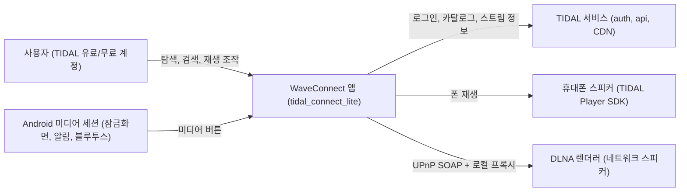

# 비즈니스 개요 (Business Overview)

## 비즈니스 맥락 도식

### 텍스트 대안
- 사용자 -> 앱: 탐색, 검색, 재생 조작
- 앱 -> TIDAL: OAuth 로그인, 카탈로그/즐겨찾기 조회, 재생 정보(playbackinfo) 요청
- 앱 -> 휴대폰: 네이티브 TIDAL Player SDK로 재생
- 앱 -> DLNA 렌더러: UPnP SOAP 명령, 오디오는 앱 내 로컬 HTTP 프록시(포트 8765)로 제공
- Android 미디어 세션 -> 앱: 잠금화면·알림·블루투스 버튼

## 비즈니스 설명
- **비즈니스 설명**: `pubspec.yaml` 설명대로 "A lightweight Tidal player and DLNA controller for Android". 사용자는 TIDAL 계정으로 로그인해 카탈로그를 탐색·검색하고, 휴대폰 또는 같은 Wi-Fi의 DLNA 렌더러(네트워크 스피커)로 음악을 재생한다. 앱 표시 이름은 `WaveConnect`(`lib/main.dart`). 서버 구성 요소는 없고 Android 단말 안에서만 동작한다.
- **비즈니스 트랜잭션**:
  - 로그인: WebView에서 `login.tidal.com/authorize`(PKCE) → `auth.tidal.com/v1/oauth2/token`으로 code 교환 → `/sessions`로 userId·countryCode 획득 → secure storage 저장 → 네이티브 SDK에 `updateUserCredentials`
  - 자동 로그인/토큰 갱신: 저장 토큰 복원, `refresh_token` grant로 갱신, 네이티브 SDK가 `refreshUserToken`으로 Dart에 갱신 요청
  - 탐색: 신규 앨범·추천 플레이리스트·추천 트랙(`/featured/...`), 최근 재생 목록
  - 검색: 통합 검색(`/search`) 및 유형별 검색, 검색 기록 저장
  - 아티스트/앨범/플레이리스트 상세 조회와 페이지네이션
  - 즐겨찾기 조회·추가·삭제(트랙, 앨범, 아티스트, 플레이리스트)
  - 폰 재생: 대기열 설정 → 네이티브 SDK `playTrack`, 갭리스 `setNextTrack`, 일시정지/재개/탐색/다음/이전, 셔플·반복
  - DLNA 재생: SSDP로 렌더러 탐색 → 렌더러 선택 → `playbackinfopostpaywall`로 스트림 정보 획득 → 프록시 등록(`registerTrackStream`) → `SetAVTransportURI`/`Play`, 1초 주기 위치 폴링, 볼륨 제어
  - 음질 설정(LOW/HIGH/LOSSLESS/HI_RES_LOSSLESS) 저장 및 다음 곡부터 적용
  - 디버그 로그 화면에서 앱 로그 확인
- **비즈니스 용어집**:
  - TIDAL: 고음질 음악 스트리밍 서비스
  - DLNA/UPnP 렌더러: 네트워크로 URL을 받아 재생하는 스피커 (AVTransport, RenderingControl 서비스)
  - SSDP: UPnP 기기 탐색용 멀티캐스트 프로토콜 (M-SEARCH)
  - DASH/MPD: 세그먼트 단위 스트리밍 형식과 그 매니페스트. LOSSLESS 요청에도 TIDAL이 DASH로 응답할 수 있음
  - 프록시 URL: `http://<LAN_IP>:8765/audio/<token>.<ext>` 형태의 단축 URL
  - 갭리스(gapless): 다음 곡을 미리 등록해 끊김 없이 넘어가는 재생
  - 미리 듣기(preview): 무료/미인증 상태의 30초 제한 재생 (`AssetPresentation.PREVIEW`)
  - Hi-Res: `HI_RES` 품질 또는 24-bit 이상 스트림

## 컴포넌트 수준 비즈니스 설명
### main
- **목적**: 앱 시작, 스플래시(자동 로그인), 하단 탭 내비게이션
- **책임**: 서비스 초기화 순서 제어, 화면 진입점 제공
### auth
- **목적**: TIDAL 계정 인증
- **책임**: PKCE 로그인, 토큰 저장·갱신, 네이티브 SDK에 자격 증명 전달
### tidal_api
- **목적**: TIDAL 카탈로그·즐겨찾기·재생 정보 접근
- **책임**: HTTP 호출, JSON → 도메인 모델 변환, 오류 분류
### player
- **목적**: 재생 경험 전체
- **책임**: 대기열, 재생 상태 단일 출처(`PlayerManager`), 폰/DLNA 출력 전환, 미디어 세션 연동, 최근 재생 기록
### dlna
- **목적**: 네트워크 스피커 재생
- **책임**: 기기 탐색, 기기 선택 유지, UPnP SOAP 제어
### explore / search / artist / favorites
- **목적**: 음악 발견과 개인 보관함
- **책임**: 추천·최근 재생 표시, 검색·기록, 아티스트·앨범·플레이리스트 상세, 즐겨찾기 관리
### settings
- **목적**: 사용자 설정과 진단
- **책임**: 음질 설정, 로그아웃 등 설정 화면, 디버그 로그 표시
### android native
- **목적**: 고음질 폰 재생과 스피커용 스트림 중계
- **책임**: TIDAL Player SDK 구동, 인증 자격 증명 제공, 로컬 HTTP 프록시와 DASH 세그먼트 연결, 볼륨·Wi-Fi lock
