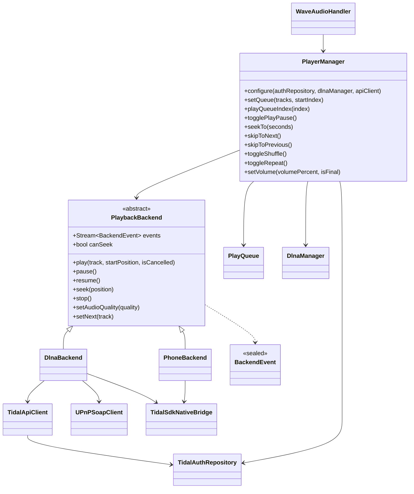

# 코드 구조 (Code Structure)

## 빌드 시스템
- **유형**: Flutter(pub) + Gradle(Kotlin DSL)
- **설정**:
  - `pubspec.yaml`: 패키지 `tidal_connect_lite`, version `1.0.0+1`, Dart SDK `>=3.0.0 <4.0.0`, assets `assets/images/`
  - `pubspec.lock`: 해석된 버전(sdks: dart `>=3.11.0`, flutter `>=3.41.0`)
  - `android/settings.gradle.kts`: AGP `8.11.1`, Kotlin Android `2.1.0`, 저장소(google, mavenCentral, jitpack, `maven.pkg.github.com/tidal-music/tidal-sdk-android`)
  - `android/app/build.gradle.kts`: namespace/applicationId `com.example.tidal_connect_lite`, minSdk 26, Java/JVM 17, 네이티브 의존성
  - `analysis_options.yaml`: `package:flutter_lints/flutter.yaml` 포함, 추가 규칙 없음
  - `config/tidal.json`(git 제외): `--dart-define-from-file`로 TIDAL 키 주입, `config/tidal.example.json`이 형식
  - `tool/check.sh`, `.github/workflows/check.yml`: 점검 파이프라인
  - `gradlew`, `local.properties`는 저장소에 없음(CI는 `flutter build apk --debug --config-only`로 생성)

## 주요 클래스/모듈

### 텍스트 대안
- `PlaybackBackend`(abstract) ← `PhoneBackend`, `DlnaBackend`; 이벤트는 sealed `BackendEvent`(`BackendStateChanged`, `BackendPositionChanged`, `BackendTrackStarted`, `BackendTrackEnded`, `BackendError`)
- `PlayerManager` → `PlayQueue`, 두 백엔드, `DlnaManager`, `TidalAuthRepository`, `TidalApiClient`
- `WaveAudioHandler` → `PlayerManager`
- Kotlin: `MainActivity` → `PlaybackCore`(object) → `TidalPlayerManager`, `TidalAuthManager` → `CustomCredentialsProvider`, `TidalStreamProxyServer` → `DashManifest`, `DashSegmentInputStream`

### 기존 파일 목록

**Dart (`lib/`)**
- `lib/main.dart` - 앱 진입점: ProviderContainer, 네이티브 SDK 초기화, PlayerManager 구성, 음질·최근 재생 연결, AudioService 초기화, `TidalConnectLiteApp`
- `lib/core/config/tidal_config.dart` - dart-define으로 받는 clientId 등 키와 auth/api 기본 URL, `isConfigured`
- `lib/core/native/tidal_sdk_native_bridge.dart` - MethodChannel/EventChannel 래퍼(네이티브 명령, 이벤트 스트림, 네이티브→Dart 콜백 처리)
- `lib/core/providers.dart` - Riverpod Provider 정의(auth, api, dlna, player, settings, favorites, recentlyPlayed)
- `lib/core/theme/app_colors.dart` - 색상 상수
- `lib/core/theme/app_theme.dart` - 다크 테마(`AppTheme.darkTheme`)
- `lib/core/utils/app_logger.dart` - 메모리 로그 수집기(디버그 로그 화면용)
- `lib/core/utils/format.dart` - 시간 등 표시 형식 함수
- `lib/core/utils/paginator.dart` - `PageResult` 기반 페이지네이션 `ChangeNotifier`
- `lib/core/widgets/error_retry_view.dart` - 오류와 재시도 버튼 위젯
- `lib/core/widgets/favorite_button.dart` - 즐겨찾기 토글 버튼
- `lib/core/widgets/load_more_indicator.dart` - 더 불러오기 표시 위젯
- `lib/core/widgets/quality_badge.dart` - 음질 배지 위젯
- `lib/core/widgets/track_tile.dart` - 트랙 목록 행 위젯
- `lib/features/artist/presentation/artist_detail_screen.dart` - 아티스트 상세 화면(인기 트랙, 앨범)
- `lib/features/auth/data/secure_storage_service.dart` - flutter_secure_storage 기반 토큰 저장
- `lib/features/auth/data/tidal_auth_repository.dart` - 토큰 발급·교환·갱신, 세션 조회, 로그아웃, 네이티브 자격 증명 전달(`NativeCredentialsSink`)
- `lib/features/auth/data/tidal_pkce_auth.dart` - PKCE code verifier/challenge 생성
- `lib/features/auth/domain/models/auth_token.dart` - `AuthToken` 모델
- `lib/features/auth/presentation/tidal_webview_login_modal.dart` - WebView 로그인 모달(`TidalWebViewLoginModal`)
- `lib/features/dlna/data/dlna_manager.dart` - DLNA 기기 목록·선택 상태 관리, 선택 저장·복원, `DlnaPosition`
- `lib/features/dlna/data/ssdp_discovery_service.dart` - SSDP M-SEARCH와 기기 설명 XML 해석
- `lib/features/dlna/data/upnp_soap_client.dart` - AVTransport/RenderingControl SOAP 클라이언트, `DidlMetadata`
- `lib/features/dlna/domain/models/dlna_device.dart` - `DlnaDevice` 모델
- `lib/features/explore/presentation/explore_screen.dart` - 탐색(홈) 화면
- `lib/features/explore/presentation/recently_played_section.dart` - 최근 재생 섹션 위젯
- `lib/features/favorites/data/favorites_repository.dart` - 즐겨찾기 ID 캐시와 추가·삭제
- `lib/features/favorites/presentation/album_detail_screen.dart` - 앨범 상세 화면
- `lib/features/favorites/presentation/my_collection_screen.dart` - 내 보관함 화면
- `lib/features/favorites/presentation/playlist_artwork_widget.dart` - 플레이리스트 아트워크 위젯
- `lib/features/favorites/presentation/playlist_detail_screen.dart` - 플레이리스트 상세 화면
- `lib/features/main/presentation/main_screen.dart` - 하단 탭 메인 화면
- `lib/features/main/presentation/splash_screen.dart` - 스플래시와 자동 로그인
- `lib/features/player/data/backends/dlna_backend.dart` - DLNA 출력 백엔드(프록시 등록, SOAP 제어, 1초 폴링)
- `lib/features/player/data/backends/phone_backend.dart` - 폰 출력 백엔드(네이티브 이벤트 → `BackendEvent`)
- `lib/features/player/data/backends/playback_backend.dart` - 백엔드 인터페이스, 이벤트, `StreamQuality`, `PlaybackException`
- `lib/features/player/data/player_manager.dart` - 재생 상태 단일 출처(싱글톤), 대기열·출력 전환·볼륨
- `lib/features/player/data/recently_played_store.dart` - 최근 재생 목록 저장(SharedPreferences)
- `lib/features/player/data/wave_audio_handler.dart` - audio_service 핸들러(잠금화면·알림·블루투스·원격 볼륨)
- `lib/features/player/domain/play_queue.dart` - 대기열, 셔플, 반복
- `lib/features/player/presentation/mini_player_widget.dart` - 미니 플레이어
- `lib/features/player/presentation/now_playing_screen.dart` - 전체 재생 화면
- `lib/features/player/presentation/speaker_selector_modal.dart` - 출력 기기 선택 모달
- `lib/features/search/data/search_history_store.dart` - 검색 기록 저장
- `lib/features/search/presentation/search_screen.dart` - 검색 화면
- `lib/features/settings/data/playback_settings.dart` - 음질 설정 저장·로드
- `lib/features/settings/presentation/debug_log_screen.dart` - 로그 콘솔 화면
- `lib/features/settings/presentation/settings_screen.dart` - 설정 화면(계정, 스피커, 음질, 로그)
- `lib/features/tidal_api/data/api_failure.dart` - API 오류 분류
- `lib/features/tidal_api/data/auth_interceptor.dart` - dio 인터셉터(토큰 첨부, 401 복구)
- `lib/features/tidal_api/data/tidal_api_client.dart` - TIDAL API v1 클라이언트, `TidalPlaybackInfo`, `PageResult`, `SearchResults`, `FavoriteType`
- `lib/features/tidal_api/domain/models/media_item.dart` - `MediaTrack`/`MediaAlbum`/`MediaPlaylist`/`MediaArtist`, 이미지 URL, 음질 해석·표시

**Kotlin (`android/app/src/main/kotlin/com/example/tidal_connect_lite/`)**
- `android/app/src/main/kotlin/com/example/tidal_connect_lite/MainActivity.kt` - `AudioServiceActivity` 상속, `configureFlutterEngine`에서 `PlaybackCore.attach` 호출
- `android/app/src/main/kotlin/com/example/tidal_connect_lite/PlaybackCore.kt` - 프로세스 범위 object: MethodChannel/EventChannel 처리, 볼륨, Wi-Fi lock, 프록시 기동, Dart 콜백(`refreshUserToken`, `refreshTrackStream`)
- `android/app/src/main/kotlin/com/example/tidal_connect_lite/TidalPlayerManager.kt` - TIDAL Player SDK 구동과 이벤트 변환(state/transition/position/ended/error)
- `android/app/src/main/kotlin/com/example/tidal_connect_lite/TidalAuthManager.kt` - SDK 인증 초기화와 사용자 자격 증명 설정
- `android/app/src/main/kotlin/com/example/tidal_connect_lite/CustomCredentialsProvider.kt` - SDK `CredentialsProvider` 구현, 만료 시 Dart에 갱신 요청
- `android/app/src/main/kotlin/com/example/tidal_connect_lite/TidalStreamProxyServer.kt` - NanoHTTPD 로컬 프록시(포트 8765, `/audio/`, `/ping`)
- `android/app/src/main/kotlin/com/example/tidal_connect_lite/DashManifest.kt` - MPD(SegmentTemplate/SegmentTimeline) 해석
- `android/app/src/main/kotlin/com/example/tidal_connect_lite/DashSegmentInputStream.kt` - DASH 세그먼트를 하나의 InputStream으로 연결

**Android 기타 (`android/app/src/`)**
- `android/app/src/main/AndroidManifest.xml` - 권한, Activity, audio_service 서비스·리시버, cleartext 허용
- `android/app/src/debug/AndroidManifest.xml` - debug 빌드 INTERNET 권한
- `android/app/src/profile/AndroidManifest.xml` - profile 빌드 INTERNET 권한
- `android/app/src/main/res/values/styles.xml`, `android/app/src/main/res/values-night/styles.xml`, `android/app/src/main/res/values-v31/styles.xml` - 실행·일반 테마
- `android/app/src/main/res/values/colors.xml` - 색상 리소스
- `android/app/src/main/res/drawable/launch_background.xml`, `android/app/src/main/res/drawable-v21/launch_background.xml` - 실행 화면 배경
- `android/app/src/main/res/mipmap-*/` - 앱 아이콘 PNG 6개
- `android/app/src/main/java/io/flutter/plugins/GeneratedPluginRegistrant.java` - Flutter 자동 생성 파일(git 제외, `android/.gitignore`)

**Kotlin 테스트**
- `android/app/src/test/kotlin/com/example/tidal_connect_lite/DashManifestTest.kt` - DashManifest 해석 단위 테스트

## 설계 패턴
### Single Source of Truth + Observer
- **위치**: `lib/features/player/data/player_manager.dart`
- **목적**: 재생 상태를 한 곳에서만 바꾸고 화면은 구독만 한다
- **구현**: `ValueNotifier` 필드를 화면이 `ValueListenableBuilder` 등으로 구독, 백엔드 이벤트 스트림에서만 갱신

### Strategy (출력 백엔드)
- **위치**: `lib/features/player/data/backends/`
- **목적**: 폰/DLNA 출력 전환
- **구현**: `PlaybackBackend` 추상 클래스와 `PhoneBackend`/`DlnaBackend` 구현, sealed `BackendEvent`

### 요청 취소 토큰
- **위치**: `PlayerManager.playQueueIndex`, `PlaybackBackend.play`
- **목적**: 빠른 연속 재생 요청 시 오래된 요청이 늦게 적용되는 것을 방지
- **구현**: `_requestSeq` 증가와 `IsCancelled` 콜백

### Singleton
- **위치**: `PlayerManager.instance`, `DlnaManager.instance`, Kotlin `object PlaybackCore`
- **목적**: 프로세스 수명 동안 재생·기기 상태 유지
- **구현**: private 생성자 + static final 인스턴스, Kotlin object

### Dependency Injection (Riverpod)
- **위치**: `lib/core/providers.dart`, `test/helpers/app_overrides.dart`
- **목적**: 서비스 연결과 테스트 시 교체
- **구현**: `Provider`/`ChangeNotifierProvider`, 테스트에서 override와 fake

### Repository / Interceptor
- **위치**: `TidalAuthRepository`, `FavoritesRepository`, `AuthInterceptor`
- **목적**: 데이터 출처 캡슐화, 토큰 첨부와 401 복구 일원화
- **구현**: dio `Interceptor`, `ChangeNotifier` 저장소

### Reverse Proxy (토큰 URL 단축)
- **위치**: `TidalStreamProxyServer.kt`
- **목적**: 렌더러가 받기 어려운 긴 토큰 URL·DASH를 짧은 HTTP URL로 제공
- **구현**: SecureRandom 토큰 → `StreamInfo` LRU 맵, 요청 IP를 `allowedHost`(렌더러)와 비교, DASH 세그먼트 연결, 만료 시 재등록(`refreshStream`, PlaybackCore가 Dart `refreshTrackStream` 호출)

## 핵심 의존성
### flutter_riverpod
- **버전**: 2.4.9
- **사용**: `lib/core/providers.dart`, 화면의 `ref.watch/read`
- **목적**: DI와 상태 구독
### dio
- **버전**: 5.4.0
- **사용**: `TidalApiClient`, `TidalAuthRepository`, `UPnPSoapClient`, `SSDPDiscoveryService`
- **목적**: HTTP 클라이언트
### audio_service
- **버전**: 0.18.19
- **사용**: `lib/main.dart`, `wave_audio_handler.dart`
- **목적**: 미디어 세션, 알림, 포그라운드 서비스
### flutter_secure_storage
- **버전**: 9.0.0
- **사용**: `secure_storage_service.dart`
- **목적**: 토큰 보안 저장
### com.tidal.sdk:player / com.tidal.sdk:auth
- **버전**: 0.0.70 / 0.10.1
- **사용**: `TidalPlayerManager.kt`, `TidalAuthManager.kt`, `CustomCredentialsProvider.kt`
- **목적**: 폰 고음질 재생과 SDK 인증
### org.nanohttpd:nanohttpd
- **버전**: 2.3.1
- **사용**: `TidalStreamProxyServer.kt`
- **목적**: 로컬 HTTP 프록시
