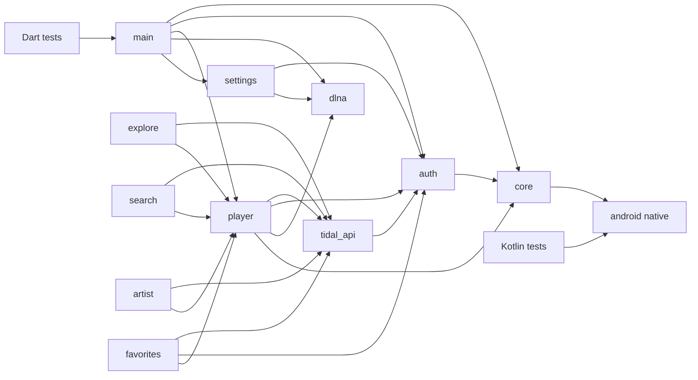

# 의존성 (Dependencies)

## 내부 의존성

### 텍스트 대안
- main -> core, auth, player, dlna, settings
- explore, search, artist -> tidal_api, player
- favorites -> tidal_api, auth, player
- settings -> auth, dlna
- player -> tidal_api, auth, dlna, core
- tidal_api -> auth
- auth -> core (`TidalSdkNativeBridge`)
- core -> android native (플랫폼 채널, 런타임)
- Dart tests -> 앱 전체, Kotlin tests -> android native

### main 이 core, auth, player, dlna, settings 에 의존
- **유형**: Compile
- **이유**: `lib/main.dart`가 Provider로 서비스를 읽어 초기화 순서를 구성

### explore / search / artist / favorites 가 tidal_api, player 에 의존
- **유형**: Compile
- **이유**: 화면이 API로 목록을 받고 `PlayerManager.setQueue`로 재생

### player 가 tidal_api, auth, dlna 에 의존
- **유형**: Compile
- **이유**: `DlnaBackend`가 재생 정보를 조회하고, `PlayerManager.configure`가 `TidalAuthRepository`·`DlnaManager`·`TidalApiClient`를 받음

### tidal_api 가 auth 에 의존
- **유형**: Compile
- **이유**: `AuthInterceptor`가 토큰 획득·401 복구에 `TidalAuthRepository` 사용

### auth, player 가 core(TidalSdkNativeBridge) 를 거쳐 android native 에 의존
- **유형**: Runtime
- **이유**: MethodChannel/EventChannel 호출. 컴파일 의존은 없고 채널 이름·메서드 이름 문자열로 결합

### Dart tests 가 앱 코드에 의존
- **유형**: Test
- **이유**: `test/helpers/`의 fake와 Provider override로 서비스를 바꿔 끼워 검증

### Kotlin tests 가 android native 에 의존
- **유형**: Test
- **이유**: `DashManifest.parse` 검증

## 외부 의존성

### Dart (pubspec.lock 해석 버전)

### flutter_riverpod
- **버전**: 2.4.9 (제약 ^2.4.9)
- **목적**: DI·상태 구독
- **라이선스**: MIT

### flutter_secure_storage
- **버전**: 9.0.0 (제약 ^9.0.0)
- **목적**: 토큰 보안 저장
- **라이선스**: BSD-3-Clause

### dio
- **버전**: 5.4.0 (제약 ^5.4.0)
- **목적**: HTTP(TIDAL API, SOAP, 기기 설명 XML)
- **라이선스**: MIT

### google_fonts
- **버전**: 6.3.3 (제약 ^6.2.1)
- **목적**: 테마 글꼴
- **라이선스**: Apache-2.0

### webview_flutter
- **버전**: 4.14.1 (제약 ^4.7.0)
- **목적**: TIDAL 로그인 WebView
- **라이선스**: BSD-3-Clause

### webview_flutter_android
- **버전**: 4.12.0 (제약 ^4.12.0)
- **목적**: WebView Android 구현
- **라이선스**: BSD-3-Clause

### crypto
- **버전**: 3.0.7 (제약 ^3.0.7)
- **목적**: PKCE SHA-256 code challenge
- **라이선스**: BSD-3-Clause

### audio_service
- **버전**: 0.18.19 (제약 ^0.18.19)
- **목적**: 미디어 세션·알림·포그라운드 서비스
- **라이선스**: MIT

### xml
- **버전**: 6.6.1 (제약 ^6.5.0)
- **목적**: UPnP 기기 설명·SOAP 응답 해석
- **라이선스**: MIT

### shared_preferences
- **버전**: 2.5.6 (제약 ^2.3.0)
- **목적**: 음질, 검색 기록, 최근 재생, 선택 기기 저장
- **라이선스**: BSD-3-Clause

### flutter_lints (dev)
- **버전**: 5.0.0 (제약 ^5.0.0)
- **목적**: 린트 규칙
- **라이선스**: BSD-3-Clause

### flutter / flutter_test (SDK)
- **버전**: Flutter 3.41.7 (CI)
- **목적**: 프레임워크, 테스트
- **라이선스**: BSD-3-Clause

### Android (android/app/build.gradle.kts)

### com.tidal.sdk:player
- **버전**: 0.0.70
- **목적**: 폰 재생 엔진
- **라이선스**: 미확인

### com.tidal.sdk:auth
- **버전**: 0.10.1
- **목적**: SDK 자격 증명 인터페이스
- **라이선스**: 미확인

### org.nanohttpd:nanohttpd
- **버전**: 2.3.1
- **목적**: 로컬 HTTP 프록시
- **라이선스**: BSD-3-Clause

### com.squareup.okhttp3:okhttp
- **버전**: 4.12.0
- **목적**: 프록시의 CDN·DASH 세그먼트 요청 (`TidalStreamProxyServer.kt`, `DashSegmentInputStream.kt`)
- **라이선스**: Apache-2.0

### junit:junit (test)
- **버전**: 4.13.2
- **목적**: Kotlin 단위 테스트
- **라이선스**: EPL-1.0

### 빌드 플러그인
- **버전**: com.android.application 8.11.1, org.jetbrains.kotlin.android 2.1.0, dev.flutter.flutter-plugin-loader 1.0.0
- **목적**: Android/Kotlin/Flutter 빌드
- **라이선스**: 미확인

전이 의존성은 `pubspec.lock`에 기록되어 있으며 여기서는 직접 의존성만 다룬다. TIDAL SDK는 GitHub Packages 저장소(`maven.pkg.github.com/tidal-music/tidal-sdk-android`)에서 받는다.
